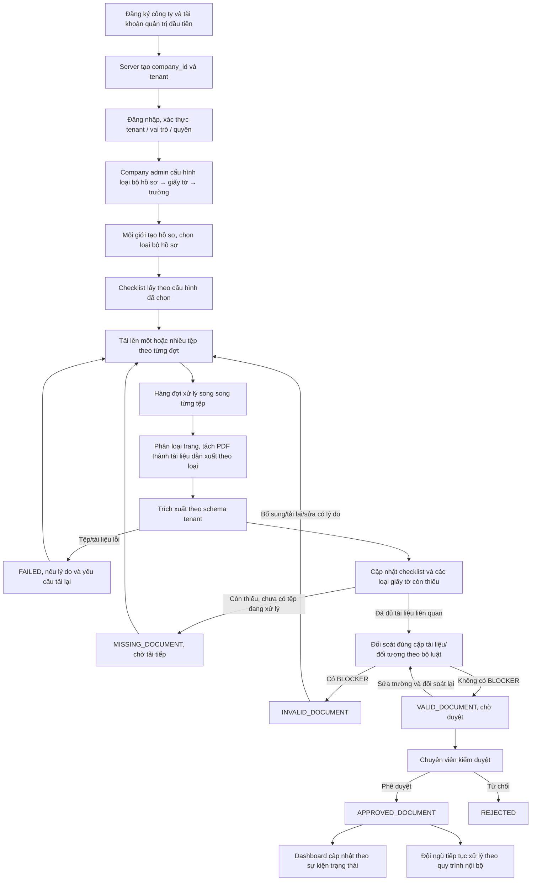
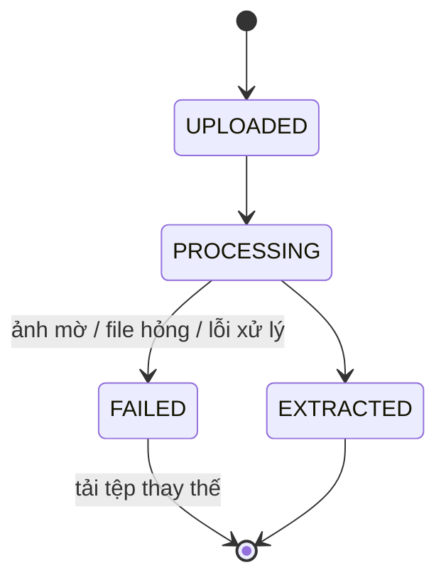
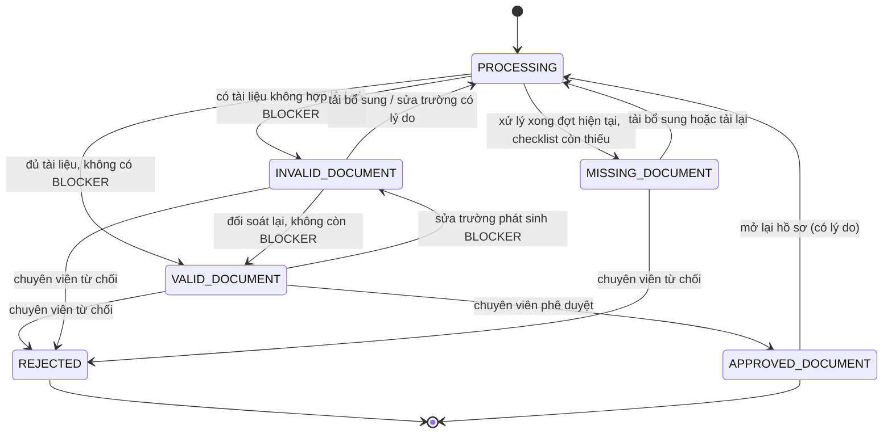
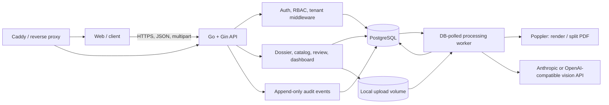

# Tài liệu Thiết kế Luồng & Tính năng

**Dự án:** AI Document Processing Platform for Real Estate  
**Sự kiện:** SEA x OpenAI Codex Hackathon  
**Tài liệu liên quan:** [README và hướng dẫn chạy backend](README.md) · [OpenAPI](docs/api/api_spec.json) · [Đặc tả khởi tạo Auth](docs/superpowers/specs/2026-10-16-auth-module-design.md)

> Tài liệu này kết hợp yêu cầu sản phẩm với blueprint để dựng một backend tương tự. Yêu cầu nghiệp vụ nằm ở các mục 1–9; mục 10 ghi nhận hiện trạng source và những điểm chưa triển khai để không nhầm thiết kế với tính năng đã chạy.

---

## 1. Tổng quan

Nền tảng đa tenant tiếp nhận hồ sơ theo nhiều đợt, phân loại và trích xuất từng tài liệu theo cấu hình của từng công ty, sau đó đối soát chéo khi đã nhận đủ giấy tờ liên quan. Mỗi công ty tự định nghĩa các loại bộ hồ sơ, tập giấy tờ thuộc từng loại và các trường cần scan của từng loại giấy tờ. Chuyên viên pháp lý kiểm tra và phê duyệt hồ sơ trước khi đội ngũ tiếp tục xử lý ở hệ thống nghiệp vụ của mình.

**Đơn vị xử lý chính là bộ hồ sơ (Dossier):** mỗi bộ hồ sơ thuộc một loại do công ty định nghĩa, ví dụ “Mua bán”, “Cho thuê” hoặc loại tùy chỉnh. Một loại bộ hồ sơ khai báo các loại giấy tờ được dùng; mỗi loại giấy tờ khai báo schema các trường cần trích xuất. Tệp có trạng thái xử lý kỹ thuật riêng; checklist theo dõi giấy tờ cần có; bộ hồ sơ có trạng thái nghiệp vụ riêng.

**Đơn vị phân tách dữ liệu là công ty (Tenant):** mỗi tài khoản thuộc một công ty; mọi dữ liệu nghiệp vụ và truy vấn đều được giới hạn theo `company_id`. Mỗi công ty có thể tự cấu hình loại giấy tờ, schema trích xuất và yêu cầu kiểm tra đặc biệt.

### 1.1. Vai trò người dùng

Quyền được gán theo tài khoản và kiểm tra ở phía server cho từng API/hành động. Một người có thể mang nhiều vai trò hoặc quyền bổ sung theo phạm vi hồ sơ. Giao diện chỉ ẩn/hiện thao tác theo quyền; server vẫn phải từ chối yêu cầu không được phép.

| Vai trò                                       | Phạm vi mặc định                                                                                                                                                 |
| :-------------------------------------------- | :--------------------------------------------------------------------------------------------------------------------------------------------------------------- |
| **Môi giới / Nhân viên tiếp nhận**            | Tạo hồ sơ, tải giấy tờ theo từng đợt, xem checklist và lỗi ở dạng đã che PII; không sửa dữ liệu trích xuất hoặc phê duyệt.                                       |
| **Chuyên viên pháp lý**                       | Thẩm định hồ sơ được phân công, sửa trường có lý do, xử lý cảnh báo, phê duyệt/từ chối/mở lại; được xem PII khi có quyền `PII_VIEW`.                             |
| **Công chứng viên**                           | Xem và xác minh hồ sơ được phân công theo quyền được cấp; quyền xem PII là quyền riêng, phải được cấp rõ ràng và được ghi audit log.                             |
| **Quản lý công ty**                           | Theo dõi hồ sơ, phân công và xem dashboard/audit trong công ty; quyền phê duyệt hoặc xem PII phải được cấp riêng nếu nghiệp vụ cần.                              |
| **Quản trị viên công ty (`company_admin`)**   | Toàn quyền quản trị trong công ty mình: quản lý thành viên, cấu hình loại bộ hồ sơ/giấy tờ, xem PII và dashboard. Mỗi lần xem PII đầy đủ vẫn phải ghi audit log. |
| **Quản trị viên nền tảng (`platform_admin`)** | Quản trị vận hành toàn hệ thống. Truy cập dữ liệu tenant phải có quyền hỗ trợ riêng và được audit; không mặc định được xem PII.                                  |
| **Hệ thống**                                  | Xử lý tệp, trích xuất, kiểm tra, cập nhật trạng thái và ghi audit log.                                                                                           |

Tài khoản đầu tiên đăng ký công ty trở thành `company_admin` của tenant vừa tạo. Chỉ người đang có vai trò `company_admin` mới được mời/tạo tài khoản thành viên trong công ty và gán vai trò cho họ. `company_admin` có thể cấp vai trò `company_admin` cho thành viên khác; các thành viên không thể tự đăng ký vào công ty, tự chọn `company_id` hoặc tự nâng quyền. Quyền `PII_VIEW` được cấp mặc định theo vai trò `company_admin`, chỉ trong tenant của người đó; thao tác hiện PII luôn được audit.

Quyền hiệu lực của `company_admin` luôn bao gồm `PII_VIEW` và `dashboard:read`; cấu hình quyền bổ sung không thể vô tình gỡ quyền mặc định này. PII và tài liệu vẫn bị giới hạn tenant; mỗi lần đọc giá trị nhạy cảm hoặc ảnh gốc được audit.

### 1.2. Cấu hình phân tầng bộ hồ sơ → giấy tờ → trường trích xuất

Quản trị viên công ty cấu hình theo ba tầng:

1. **Loại bộ hồ sơ:** công ty tạo các loại như “Mua bán”, “Cho thuê” hoặc loại nghiệp vụ riêng. Đây là cấu hình theo tenant, không phải danh sách enum cố định trong hệ thống.
2. **Loại giấy tờ trong bộ hồ sơ:** quản trị viên chọn các loại giấy tờ được dùng, rồi cấu hình vai trò của từng loại trong checklist: bắt buộc, có điều kiện, thứ tự hiển thị và điều kiện áp dụng. Một loại giấy tờ có thể được dùng trong nhiều loại bộ hồ sơ.
3. **Trường của loại giấy tờ:** mỗi loại giấy tờ có mô tả nhận diện, danh sách trường cần scan (ví dụ họ tên, ngày sinh, địa chỉ), kiểu dữ liệu, bắt buộc/tuỳ chọn, PII và validation. Có thể khai báo yêu cầu kiểm tra đặc biệt cho giấy tờ đó.

Ví dụ cấu hình mẫu:

| Loại bộ hồ sơ | Các loại giấy tờ trong checklist                                                                        | Ví dụ giấy tờ phát sinh theo điều kiện                                                                                                 |
| :------------ | :------------------------------------------------------------------------------------------------------ | :------------------------------------------------------------------------------------------------------------------------------------- |
| **Mua bán**   | Sổ đỏ/Sổ hồng, CCCD bên mua, CCCD bên bán, Xác nhận tình trạng hôn nhân, Hợp đồng chuyển nhượng/đặt cọc | Bên bán đã kết hôn và tài sản chung → CCCD vợ/chồng, Giấy chứng nhận kết hôn. Sổ ghi CMND cũ → giấy xác nhận CMND/CCCD cùng một người. |
| **Cho thuê**  | Giấy tờ sở hữu, CCCD bên cho thuê, CCCD bên thuê, Hợp đồng thuê                                         | Người cho thuê không phải chủ sở hữu → Giấy/Hợp đồng ủy quyền.                                                                         |

Các loại mẫu trên chỉ là dữ liệu khởi tạo/gợi ý. Công ty có thể thêm, đổi tên, ngừng dùng hoặc tạo loại bộ hồ sơ tùy chỉnh mà không cần sửa mã nguồn. Hệ thống không dùng `SALE`/`LEASE` làm tập giá trị đóng để quyết định checklist hay luật xử lý.

**Tự sinh mã cấu hình:** người dùng nhập tên/nhãn; server tự tạo `code` cho loại bộ hồ sơ và loại giấy tờ, cùng `key` cho trường trích xuất. Mã loại bộ hồ sơ/giấy tờ được sinh kèm hậu tố duy nhất và được bảo vệ bằng unique constraint `(company_id, code)`; mã trường được kiểm tra duy nhất trong schema (hiện trường được lưu dạng JSON). Mã yêu cầu đặc biệt cũng được sinh từ mô tả và kiểm tra trong cấu hình giấy tờ. Mã bất biến sau khi tạo; đổi tên hiển thị không đổi mã. Người dùng không cần nhập code hoặc tự bảo đảm tính duy nhất.

Hồ sơ có thể được tạo trước khi thu thập đủ giấy tờ. Checklist được sinh từ phiên bản cấu hình loại bộ hồ sơ đã chọn và cho biết còn thiếu loại nào; môi giới có thể tải tiếp vào một thời điểm khác. Tài liệu mới sẽ kích hoạt xử lý lại và đối soát các cặp dữ liệu liên quan đã được cấu hình cho loại bộ hồ sơ đó.

### 1.3. Tiếp nhận nhiều tệp, tách PDF và xử lý song song

API upload nhận nhiều tệp trong một request. Mỗi tệp đầu vào có trạng thái và kết quả riêng; các tệp độc lập được đưa vào hàng đợi xử lý song song có giới hạn tài nguyên. Một tệp lỗi không làm hủy hoặc đổi trạng thái các tệp còn lại. Việc cập nhật checklist/trạng thái hồ sơ phải an toàn khi nhiều tệp cùng hoàn tất.

API `GET /api/v1/dossiers/{id}` chỉ lấy chi tiết hồ sơ; upload tệp dùng `POST /api/v1/dossiers/{id}/files` với multipart form data. Vì vậy, ví dụ curl được gửi kèm cần đổi sang endpoint `/files` và phương thức `POST` nếu mục đích là tải tài liệu.

Nếu một PDF chứa nhiều loại giấy tờ, hệ thống giữ tệp gốc làm nguồn, phân loại theo trang, nhận diện ranh giới từng tài liệu rồi tạo tệp dẫn xuất riêng cho từng tài liệu/nhóm trang. Mỗi tệp dẫn xuất được gắn đúng loại giấy tờ, lưu cùng hồ sơ và liên kết ngược về tệp gốc cùng số trang nguồn. Nhiều tài liệu cùng loại trong một PDF vẫn phải giữ thành các bản ghi riêng nếu là các tài liệu/đối tượng khác nhau; không gộp chỉ vì trùng loại giấy tờ. Trang `UNKNOWN`, ranh giới không chắc chắn hoặc không đủ độ tin cậy được chuyển sang chờ phân loại thủ công, không tự gán vào tệp khác.

Nếu khách hàng tải riêng từng tệp cho từng loại giấy tờ, mỗi tệp được xử lý độc lập và đồng thời trong giới hạn worker cấu hình. Khi request có gửi `document_types`, mỗi giá trị ghép theo thứ tự với một tệp; server xác thực mã thuộc checklist của hồ sơ. Nếu không gửi, hệ thống tự phân loại.

### 1.4. Luật đối soát và gợi ý bằng AI

Luật đối soát là cấu hình có kiểu dữ liệu, gồm hai nguồn (loại giấy tờ, trường, vai trò/đối tượng cần so sánh), phép so sánh, mức độ, thông báo và hướng xử lý. Nếu một loại giấy tờ có thể xuất hiện nhiều lần (ví dụ CCCD bên mua và bên bán), luật phải xác định cặp tài liệu cùng đối tượng; không lấy một giá trị “tin cậy cao nhất” bất kỳ trong cả hồ sơ để so sánh.

AI có thể đề xuất luật dựa trên tên/mô tả loại hồ sơ, mô tả giấy tờ, schema trường và special requirements. Gợi ý gồm cặp trường, phép so sánh, mức độ, lý do, điều kiện nguồn và độ tin cậy. Chỉ gửi cấu hình/schema; không gửi ảnh, PII hay dữ liệu hồ sơ thật để tạo gợi ý. Gợi ý là bản nháp; `company_admin` phải kiểm tra, sửa và chọn lưu thành phiên bản cấu hình mới. AI không tự bật luật hoặc tự kết luận hồ sơ hợp lệ.

**Quy tắc kết quả:** `PENDING_DOCUMENTS` dùng khi thiếu giấy tờ/đối tượng nguồn; kết quả khớp mới được `RESOLVED`; sai lệch chỉ thành `BLOCKER` khi hai giá trị có thể so sánh, đủ độ tin cậy và được ghép đúng đối tượng. Giá trị thiếu, sai định dạng, độ tin cậy thấp, đối tượng mơ hồ hoặc không chuẩn hóa được phải chuyển `WARNING`/cần chuyên viên xác minh, không tự kết luận sai lệch nghiêm trọng. Ngày không parse được không được coi là khớp chỉ vì chuỗi nhập giống nhau.

**Hiện trạng rule engine đã đối chiếu source (2026-10-30):**

- Luật cấu hình lấy dữ liệu theo `document_type` + `document_group_id` + `field_key`; nếu có nhiều tài liệu cùng loại, chỉ tự ghép khi hai trường chủ thể tạo ra đúng một cặp. Ghép thiếu hoặc không duy nhất sẽ thành cảnh báo cần người kiểm tra.
- Trường được dùng tự động khi confidence đạt `0.8` trở lên hoặc đã được chuyên viên sửa. Các giá trị mơ hồ, confidence thấp, validation không hợp lệ, thiếu trường hoặc không chuẩn hóa được không bị coi là sai lệch `BLOCKER`.
- `TEXT_EQUALS` chuẩn hóa chữ; `DIGITS_EQUAL` so các chữ số; `DATE_EQUAL` chỉ so ngày parse được; `NUMBER_EQUAL` chuẩn hóa số, một số dạng tiền Việt và áp dụng sai số rất nhỏ.
- Khi lưu cấu hình, server kiểm tra loại giấy tờ/trường có nằm trong loại bộ hồ sơ không và operator có tương thích kiểu trường không. Trường ghép chủ thể phải tồn tại và có kiểu text.
- Các giới hạn còn lại: chuẩn hóa tên/địa chỉ chưa phải đối sánh ngữ nghĩa; so sánh số vẫn phụ thuộc định dạng đầu vào; luật có thể cấu hình mức `BLOCKER` nên cần kiểm thử với dữ liệu nghiệp vụ trước khi dùng thật. Luật AI chỉ là gợi ý, không thay cho phê duyệt của quản trị viên.

### 1.5. Mô hình công ty và phạm vi tenant

`companies` là bảng gốc của tenant, được tạo cùng lúc với tài khoản quản trị đầu tiên. Bảng lưu thông tin đăng ký như `name`, `legal_name`, `business_registration_number`/mã số thuế, địa chỉ, email, số điện thoại, trạng thái và thời điểm tạo. `id` của bảng này chính là `company_id` được tham chiếu bởi dữ liệu thuộc công ty.

| Nhóm dữ liệu                                                                                                                      | Ràng buộc tenant                                                                                                                                  |
| :-------------------------------------------------------------------------------------------------------------------------------- | :------------------------------------------------------------------------------------------------------------------------------------------------ |
| `users`                                                                                                                           | Có `company_id`; username và email hiện có unique index toàn hệ thống (không thể trùng giữa hai công ty); vai trò/quyền được quản lý theo tenant. |
| `dossiers`, `dossier_files`, `document_groups`, `document_pages`, `extracted_fields`, checklist/yêu cầu phát sinh và lỗi đối soát | Có `company_id`; bản ghi con phải cùng tenant với hồ sơ cha.                                                                                      |
| `company_dossier_types`                                                                                                           | Catalog loại bộ hồ sơ theo công ty; có `company_id`, mã sinh tự động và phiên bản cấu hình.                                                       |
| `dossier_type_documents`                                                                                                          | Quan hệ phiên bản giữa loại bộ hồ sơ và loại giấy tờ; chứa bắt buộc/điều kiện/thứ tự, phiên bản schema và `company_id`.                           |
| Loại giấy tờ và phiên bản schema                                                                                                  | Có `company_id`; mỗi công ty tự quản lý catalog, mã sinh tự động, trường trích xuất và special requirements.                                      |
| Luật đối soát theo loại bộ hồ sơ                                                                                                  | Có `company_id` và tham chiếu loại bộ hồ sơ; định nghĩa các trường/loại giấy tờ nguồn cần so sánh.                                                |
| Audit log và lịch sử trạng thái                                                                                                   | Có `company_id` để phân quyền đọc, điều tra và thống kê theo tenant.                                                                              |
| `companies`                                                                                                                       | Bảng tenant gốc; khóa chính `id` được tham chiếu làm `company_id` ở các bảng nghiệp vụ.                                                           |

`company_id` ở bản ghi mới phải lấy từ context xác thực phía server. Với mọi thao tác đọc/ghi, server kiểm tra tenant của cả tài nguyên đích và các bản ghi liên quan; không tin `company_id` gửi từ client. Có thể lưu lặp `company_id` ở bảng con để lọc hiệu quả, nhưng phải giữ ràng buộc toàn vẹn để không nối dữ liệu khác tenant.

Mô hình dữ liệu cấu hình có ba tầng: `company_dossier_types` (loại bộ hồ sơ) → `dossier_type_documents` (danh sách và quy tắc đưa giấy tờ vào checklist) → `company_document_types` cùng phiên bản schema/trường (loại giấy tờ và nội dung cần scan). Hồ sơ giữ phiên bản checklist và phiên bản schema giấy tờ đã chọn.

Khi tạo hồ sơ, lưu `dossier_type_id` và phiên bản cấu hình đã chọn. Checklist cụ thể được tạo thành snapshot cho hồ sơ để thay đổi cấu hình về sau không tự ý thay đổi yêu cầu của hồ sơ đang xử lý. Loại giấy tờ được phân loại phải nằm trong tập loại giấy tờ cho phép của loại bộ hồ sơ đã chọn.

Trong luồng đăng ký, thông tin công ty và tài khoản người đại diện được gửi cùng một yêu cầu; server tạo công ty, gán `users.company_id` và vai trò `company_admin` trong một transaction. Nếu tạo tài khoản thất bại thì không để lại công ty rỗng.

---

## 2. Luồng Tổng thể (End-to-End Flow)



**Quy tắc xử lý song song:** mỗi tệp được xử lý độc lập trong một worker pool có giới hạn; lỗi của một tệp không chặn các tệp khác. Cập nhật trạng thái tổng hợp phải tính từ tất cả tệp/tài liệu con còn đang chạy.

**Quy tắc PDF nhiều tài liệu:** phân loại trang và xác định ranh giới tài liệu trước khi tạo tệp dẫn xuất. Mỗi tệp dẫn xuất lưu riêng theo tài liệu/nhóm trang, loại giấy tờ và nguồn gốc (tệp gốc, số trang); không làm mất hoặc ghi đè tệp gốc.

**Quy tắc đối soát theo giai đoạn:** hệ thống có thể kiểm tra chất lượng, phân loại, trích xuất và xác thực từng tài liệu ngay khi tài liệu đó được tải lên. Luật nhiều nguồn chỉ chạy khi có đủ tài liệu và ghép được đúng đối tượng. Trước thời điểm đó, luật hiển thị `PENDING_DOCUMENTS`; thiếu confidence/không chuẩn hóa/không xác định được cặp phải chuyển chuyên viên xác minh, không phát sinh `BLOCKER` tự động.

---

## 3. Các Luồng Chi tiết (User Flows)

### Flow A — Đăng ký công ty, đăng nhập & phân quyền tenant _(Tất cả vai trò)_

1. Người đại diện đăng ký bằng thông tin công ty và thông tin tài khoản; hệ thống tạo một bản ghi `companies` cùng `company_id` mới trong cùng transaction với tài khoản đầu tiên.
2. Tài khoản đầu tiên được gán `company_admin` trong tenant đó. Chỉ `company_admin` hiện hữu mới được mời/tạo tài khoản thành viên tiếp theo và gán vai trò trong công ty; admin có thể cấp `company_admin` cho thành viên khác để cùng quản trị.
3. Người dùng đăng nhập; server nạp `user_id`, `company_id`, vai trò và quyền từ dữ liệu tin cậy. Không nhận `company_id` do client tự gửi để quyết định phạm vi truy cập.
4. Mọi truy vấn, tạo mới, cập nhật và xóa dữ liệu nghiệp vụ phải ràng buộc theo `company_id`; quan hệ giữa bản ghi con và hồ sơ phải xác minh cùng tenant.
5. Server xác thực quyền ở mỗi API/hành động: xem hồ sơ, tải tệp, sửa trường, xem PII, duyệt, quản lý người dùng/cấu hình hoặc xem audit. API tạo thành viên và gán vai trò, bao gồm cấp `company_admin`, chỉ cho phép `company_admin` thực hiện trong chính tenant của họ; mọi lần tạo thành viên/đổi vai trò được ghi audit.
6. Môi giới chỉ thấy PII đã che. `company_admin` có `PII_VIEW` mặc định trong tenant của mình; các vai trò khác cần quyền phù hợp. Mỗi lần hiện PII đều ghi audit.
7. Quản trị viên nền tảng không tự động có quyền xem hồ sơ hay PII của tenant; quyền hỗ trợ tenant phải được cấp và audit riêng.

### Flow B — Tạo hồ sơ & tải giấy tờ theo từng đợt _(Môi giới)_

1. Bấm **“Tạo hồ sơ mới”** → chọn loại bộ hồ sơ từ catalog công ty (Mua bán, Cho thuê hoặc loại tùy chỉnh), nhập tên gợi nhớ và tạo hồ sơ.
2. Hệ thống tạo checklist từ snapshot cấu hình đã chọn, gồm giấy tờ bắt buộc và giấy tờ điều kiện đang chờ xác định.
3. Môi giới tải lên một hoặc nhiều ảnh/PDF trong cùng request. Có thể tải phần giấy tờ đang có trước, rồi quay lại bổ sung các loại còn thiếu sau.
4. Mỗi tệp được xếp hàng riêng và có tiến trình `UPLOADED` → `PROCESSING` → `EXTRACTED` hoặc `FAILED`; nhiều tệp độc lập được xử lý song song có giới hạn, lỗi một tệp không làm lỗi các tệp khác.
5. Mỗi loại giấy tờ trong checklist thể hiện trạng thái riêng. Với loại chưa có, trạng thái là `MISSING_DOCUMENT`; rê chuột hoặc mở chi tiết hiển thị tên giấy tờ còn thiếu, ví dụ: **“Thiếu: CCCD bên mua, Xác nhận tình trạng hôn nhân”**. Trên màn hình cảm ứng, chạm vào trạng thái để xem chi tiết.
6. Khi kết quả trích xuất làm phát sinh yêu cầu có điều kiện (ví dụ bên bán đã kết hôn), checklist thêm giấy tờ đó và nêu lý do phát sinh.
7. Hồ sơ được lưu ở trạng thái chờ bổ sung nếu còn giấy tờ; người dùng có thể rời trang và tiếp tục tải sau.

**Ngoại lệ:**

- Tải trùng tệp (trùng `sha256`) → cảnh báo và đề xuất dùng tệp đã có.
- Một PDF chứa nhiều loại giấy tờ → hệ thống phân loại trang, xác định ranh giới tài liệu, tạo/lưu từng tệp dẫn xuất theo tài liệu và loại giấy tờ; giữ liên kết về PDF gốc và số trang nguồn.
- Một PDF chứa nhiều tài liệu cùng loại (ví dụ CCCD của nhiều người) → giữ thành các tài liệu riêng, không gộp chỉ dựa trên mã loại giấy tờ.
- Nhiều tệp đầu vào ứng với từng loại giấy tờ → API ghép `document_types` theo thứ tự nếu được cung cấp và đưa từng tệp vào xử lý song song; nếu một tệp lỗi, các tệp còn lại vẫn tiếp tục.
- Không xác định được loại/ranh giới hoặc confidence dưới ngưỡng → giữ trang trong trạng thái cần phân loại thủ công; không tạo tệp dẫn xuất sai loại.
- Tệp sai định dạng hoặc quá dung lượng → từ chối ngay, nêu rõ nguyên nhân.
- Tệp `FAILED` không được tính là đã đáp ứng loại giấy tờ tương ứng; yêu cầu tải lại/chụp lại.

### Flow C — Xử lý tài liệu & đối soát theo giai đoạn _(Hệ thống)_

1. **Tiếp nhận và xếp hàng:** ghi nhận từng file đầu vào riêng. Worker pool xử lý các file độc lập song song có giới hạn; claim job phải tránh xử lý trùng và một lỗi không hủy các job còn lại.
2. **Tiền xử lý:** PDF → ảnh từng trang; xoay thẳng và kiểm tra chất lượng. Ảnh mờ/trang hỏng → lỗi ở đúng trang/tài liệu, kèm lý do.
3. **Phân loại và phân đoạn:** gán nhãn cho từng trang trong tập loại giấy tờ thuộc đúng tenant và loại bộ hồ sơ; xác định ranh giới từng tài liệu, kể cả nhiều tài liệu cùng loại trong một PDF. `UNKNOWN`, confidence thấp hoặc ranh giới không chắc chắn được đưa cho chuyên viên phân loại.
4. **Tạo tài liệu dẫn xuất:** nhóm trang thuộc cùng một tài liệu thành file riêng (PDF hoặc định dạng đã quy định), gắn đúng loại giấy tờ, lưu quan hệ `source_file_id`/trang gốc; giữ tệp tải lên ban đầu để truy vết và tải lại. Các nhóm lỗi được cô lập.
5. **Trích xuất:** nạp schema và hướng dẫn của loại tài liệu thuộc đúng `company_id`; gửi ảnh cùng schema cho AI, nhận các trường `value`, `raw_text`, `confidence`, `source` (tài liệu, trang và đoạn gốc).
6. **Kiểm tra theo tài liệu:** xác thực định dạng, chuẩn hóa dữ liệu, đánh dấu trường PII và chạy `special_requirements` đã cấu hình. Kết quả kiểm tra gồm trạng thái, bằng chứng và confidence.
7. **Cập nhật checklist:** tài liệu đã nhận diện được gắn vào đúng loại giấy tờ; các yêu cầu phát sinh được thêm vào checklist.
8. **Kiểm tra tính đầy đủ:** xác định các loại giấy tờ bắt buộc/điều kiện còn thiếu. Nếu còn thiếu, hiển thị tên giấy tờ trong checklist và chờ đợt tải tiếp theo.
9. **Đối soát chéo:** chỉ chạy khi đủ tài liệu nguồn và ghép được đúng nhóm/đối tượng. Dùng operator tương thích kiểu trường; giá trị không parse được, confidence thấp hoặc đối tượng mơ hồ cần chuyên viên xác minh.
10. **Cập nhật trạng thái hồ sơ và ghi audit log** cho các thay đổi quan trọng; trạng thái tổng hợp không được đánh dấu hoàn tất nếu còn file/tài liệu đang chạy.

### Flow D — Bổ sung giấy tờ & xử lý lỗi _(Môi giới / Chuyên viên pháp lý)_

1. Mở hồ sơ và xem trạng thái, checklist, tệp lỗi và vấn đề đối soát. Trạng thái thiếu giấy tờ có phần giải thích khi rê chuột/chạm vào.
2. Vấn đề được nhóm thành: **Thiếu giấy tờ**, **Tệp không đọc được**, **Sai lệch dữ liệu**, **Cần xác minh**. Ví dụ: “Thiếu CCCD vợ/chồng bên bán”; “Trang 2 của `so_hong.pdf` bị mờ”.
3. Môi giới tải loại giấy tờ còn thiếu hoặc tải lại tệp lỗi vào hồ sơ hiện tại; không cần tạo hồ sơ mới.
4. Hệ thống xử lý tài liệu mới, cập nhật checklist và chạy lại các luật liên quan. Chỉ khi đã có đủ nguồn mới đưa ra kết quả đối soát chéo.
5. Môi giới không được sửa dữ liệu trích xuất. Chuyên viên có thể sửa trường kèm mã lý do/ghi chú; mọi lần sửa đều được ghi audit và đối soát lại.

### Flow E — Kiểm duyệt hồ sơ _(Chuyên viên pháp lý / `company_admin`; quyền có thể cấp cho vai trò khác)_

1. Hàng đợi duyệt chỉ hiển thị hồ sơ đã đủ tài liệu và ở trạng thái `VALID_DOCUMENT`; có thể lọc theo trạng thái, loại bộ hồ sơ, người tạo hoặc người được phân công.
2. Mở hồ sơ → xem ảnh gốc, trường đã trích xuất, bằng chứng nguồn và các cảnh báo.
3. Bấm vào trường → ảnh nhảy tới đúng trang và đoạn văn bản gốc; bấm lỗi đối soát → mở các giấy tờ liên quan cạnh nhau.
4. Sửa trường phải chọn mã lý do (`OCR_ERROR`, `SOURCE_ERROR`, `ADMIN_UNIT_CHANGE`, `OTHER`) và ghi chú khi cần; hệ thống đối soát lại sau khi sửa.
5. Xác nhận `WARNING` phải có lý do.
6. Quyết định:
   - **Phê duyệt** — chỉ bật khi đủ tài liệu, không còn `BLOCKER` và mọi `WARNING` được xử lý/xác nhận → `APPROVED_DOCUMENT`.
   - **Từ chối** — bắt buộc có lý do → `REJECTED`.
   - **Yêu cầu bổ sung** — ghi rõ giấy tờ/vấn đề cần xử lý → hồ sơ quay về trạng thái phù hợp (`MISSING_DOCUMENT` hoặc `INVALID_DOCUMENT`).

### Flow F — Xem dữ liệu nhạy cảm _(Người có quyền `PII_VIEW`, mặc định gồm `company_admin`)_

1. API mặc định trả PII đã che theo quyền, ví dụ CCCD `079*****1234`; che dữ liệu ngay phía server, không chỉ bằng CSS trên giao diện.
2. Người có quyền `PII_VIEW` bấm **“Hiện”** cạnh trường → server xác thực lại quyền, trả giá trị đầy đủ và ghi `VIEW_PII` gồm người xem, hồ sơ, trường được xem và thời điểm.
3. `company_admin` có `PII_VIEW` mặc định trong tenant của mình và có nút **“Hiện”**; mỗi lần xem vẫn ghi `VIEW_PII`. Quản trị viên nền tảng không được cấp quyền này theo mặc định.
4. Môi giới không được cấp quyền xem đầy đủ và không có nút **“Hiện”**.
5. Ảnh CCCD trả cho vai trò không có quyền xem ảnh gốc phải làm mờ vùng vân tay/mã QR. Việc xem ảnh gốc cần quyền riêng, được kiểm tra phía server và ghi audit khi truy cập.

### Flow G — Chỉnh sửa sau phê duyệt

1. Hồ sơ `APPROVED_DOCUMENT` bị khóa sửa mặc định.
2. Người được cấp quyền **“Mở lại hồ sơ”** nhập lý do; hệ thống ghi audit log, chạy lại kiểm tra và đưa hồ sơ về `VALID_DOCUMENT` hoặc `INVALID_DOCUMENT` tùy kết quả.
3. Hồ sơ phải được duyệt lại trước khi được xem là đã hoàn tất.

### Flow H — Quản trị loại bộ hồ sơ, giấy tờ và cấu hình trích xuất _(Quản trị viên công ty)_

1. Quản trị viên công ty mở **Cấu hình bộ hồ sơ**, tạo loại bộ hồ sơ (ví dụ Mua bán, Cho thuê hoặc loại riêng). Server tự sinh `code` duy nhất trong catalog công ty; mã chỉ đọc và không đổi khi sửa tên hiển thị.
2. Tạo/chọn các loại giấy tờ công ty sẽ dùng. Mỗi loại giấy tờ có `code` tự sinh duy nhất trong catalog công ty, mô tả nhận diện và schema phiên bản riêng.
3. Thêm các loại giấy tờ vào loại bộ hồ sơ; đặt bắt buộc/có điều kiện/không áp dụng, thứ tự và điều kiện. Một loại giấy tờ có thể được tái sử dụng trong nhiều loại bộ hồ sơ.
4. Trong từng loại giấy tờ, khai báo trường cần scan: nhãn, kiểu dữ liệu, bắt buộc/tuỳ chọn, PII và validation. `key`/mã trường được tự sinh và duy nhất trong schema loại giấy tờ; người dùng không cần nhập code.
5. Có thể yêu cầu agent đề xuất mô tả, dấu hiệu nhận diện và trường trích xuất. Kết quả agent chỉ là bản nháp; quản trị viên rà soát trước khi dùng.
6. Quản trị viên khai báo yêu cầu đặc biệt cho từng loại giấy tờ và luật đối soát giữa giấy tờ/trường trong loại bộ hồ sơ. Luật phải xác định vai trò/đối tượng cần so sánh khi một loại giấy tờ có thể xuất hiện nhiều lần; operator phải tương thích với kiểu dữ liệu của trường.
7. Quản trị viên có thể yêu cầu AI gợi ý luật đối soát từ mô tả và schema cấu hình. Gợi ý gồm cặp tài liệu/trường, phạm vi đối tượng, operator, mức độ, điều kiện nguồn, lý do, confidence và hướng xử lý; không gửi ảnh, PII hoặc dữ liệu hồ sơ thật. AI chỉ tạo bản nháp để admin rà soát, sửa và chọn lưu.
8. Khi duyệt/kích hoạt, hệ thống tạo phiên bản cấu hình bất biến. Thay đổi sau này tạo phiên bản mới; hồ sơ đã tạo tiếp tục dùng snapshot cấu hình lúc khởi tạo.
9. Khi OCR, hệ thống chỉ nạp cấu hình cùng `company_id`, giới hạn ứng viên phân loại theo loại bộ hồ sơ đã chọn, ghi nhận phiên bản cấu hình loại hồ sơ/giấy tờ/schema/model, rồi trích xuất và chạy các kiểm tra đã kích hoạt.
10. Kết quả kiểm tra trả trạng thái, bằng chứng, nguồn, confidence và lý do chuẩn hóa. `BLOCKER` chỉ được phát sinh khi so sánh có kiểu, đủ độ tin cậy và ghép đúng đối tượng; trường thiếu/không parse được/không rõ đối tượng cần chuyên viên xác minh. Nếu tiêu chí cần dữ liệu ngoài, phải khai báo nguồn kiểm chứng; không suy đoán chỉ từ prompt.

#### Gợi ý luật đối soát bằng AI

- Đầu vào: loại bộ hồ sơ, các loại giấy tờ được liên kết, mô tả giấy tờ, nhãn/key/kiểu trường, special requirements và vai trò/đối tượng đã khai báo.
- Đầu ra là danh sách nháp có tên luật, hai nguồn giấy tờ/trường, phạm vi đối tượng, operator, mức độ đề xuất, điều kiện dữ liệu, giải thích, confidence và hướng xử lý.
- Server kiểm tra các mã giấy tờ/trường thuộc đúng tenant và version; từ chối gợi ý tham chiếu sai trường hoặc operator không tương thích kiểu dữ liệu.
- Quản trị viên xem trước, sửa, bỏ hoặc chọn từng gợi ý rồi lưu thành version mới. Không ghi đè luật hiện tại và không tự kích hoạt luật do AI đề xuất.
- Audit lưu người yêu cầu, thời điểm, version cấu hình và lựa chọn của admin; không ghi PII/ảnh hồ sơ vào payload audit.

### Flow I — Dashboard hồ sơ theo trạng thái và thời gian _(Quản lý / Quản trị viên công ty)_

1. Người dùng mở Dashboard; API tự giới hạn kết quả theo `company_id` và quyền dashboard. `company_admin` có quyền xem dashboard mặc định.
2. Chọn ngày bắt đầu/kết thúc, múi giờ hiển thị, loại bộ hồ sơ và cách thống kê. Mặc định dashboard đếm số hồ sơ **chuyển vào từng trạng thái trong khoảng thời gian**, ví dụ hôm nay có 3 hồ sơ vào `APPROVED_DOCUMENT` và 3 hồ sơ vào `MISSING_DOCUMENT`.
3. Biểu đồ theo ngày hiển thị số lượt vào từng trạng thái; bảng số liệu có thể bấm để mở danh sách hồ sơ phù hợp trong cùng tenant.
4. Dashboard phân biệt lượt chuyển trạng thái với ảnh chụp tồn tại hiện tại. Một hồ sơ quay lại cùng trạng thái có thể có nhiều lần chuyển trạng thái; dashboard ghi rõ metric đang đếm lượt chuyển hay hồ sơ duy nhất.
5. Các mốc trạng thái phải lấy từ audit/status history có `company_id`, trạng thái trước/sau và thời điểm; không suy ra lịch sử bằng `updated_at` hiện tại của hồ sơ.

---

## 4. Vòng đời Trạng thái (State Machines)

### 4.1. Trạng thái tệp và checklist giấy tờ

Trạng thái tiến trình gắn với **tệp thực tế**:



`MISSING_DOCUMENT` thuộc về **ô loại giấy tờ trong checklist**, không phải một tệp chưa tồn tại. Checklist có thể hiển thị `MISSING_DOCUMENT`, `UPLOADED`, `PROCESSING`, `EXTRACTED`, `FAILED` hoặc `NOT_REQUIRED` (loại giấy tờ điều kiện được xác định là không cần). Tệp `FAILED` không làm ô checklist được tính là hoàn tất.

Khi hover/chạm vào `MISSING_DOCUMENT`, hiển thị tên từng loại còn thiếu và có thể kèm lý do phát sinh. Khi một tệp mới được tải, checklist cập nhật theo nhận diện; chỉ bật đối soát chéo khi có đủ tài liệu nguồn liên quan.

### 4.2. Trạng thái nghiệp vụ của bộ hồ sơ



**Quy tắc xác định trạng thái:** `PROCESSING` khi có tệp/đợt kiểm tra đang chạy; nếu không còn tiến trình nhưng thiếu giấy tờ thì `MISSING_DOCUMENT`; nếu đã nhận tài liệu nhưng có tệp/tài liệu không hợp lệ hoặc có `BLOCKER` thì `INVALID_DOCUMENT`; `VALID_DOCUMENT` chỉ khi đủ giấy tờ liên quan và không còn `BLOCKER`. Khi có cả giấy tờ thiếu và lỗi trên tài liệu đã gửi, ưu tiên `INVALID_DOCUMENT`; checklist vẫn liệt kê rõ các giấy tờ còn thiếu.

|     Biểu tượng     | Mã                  | Ý nghĩa                                                                                |
| :----------------: | :------------------ | :------------------------------------------------------------------------------------- |
|         ⏳         | `PROCESSING`        | Có tệp hoặc lượt đối soát đang chạy.                                                   |
|         📄         | `MISSING_DOCUMENT`  | Chờ tải một hoặc nhiều loại giấy tờ; hover/chạm để xem danh sách.                      |
|         ❌         | `INVALID_DOCUMENT`  | Có tài liệu không hợp lệ hoặc có lỗi `BLOCKER`; checklist vẫn cho biết phần còn thiếu. |
|   ✔️ _(Xanh lá)_   | `VALID_DOCUMENT`    | Đủ tài liệu liên quan, không có `BLOCKER`, chờ chuyên viên duyệt.                      |
| 🔲✔️ _(Viền xanh)_ | `APPROVED_DOCUMENT` | Chuyên viên đã phê duyệt; đội ngũ tiếp tục quy trình nội bộ.                           |
|         🚫         | `REJECTED`          | Bị từ chối, kèm lý do.                                                                 |

### 4.3. Trạng thái lỗi đối soát

`PENDING_DOCUMENTS` (chưa đủ nguồn) → `OPEN` (đã đủ nguồn và có vấn đề) → `RESOLVED` (đã sửa/bổ sung) hoặc `ACKNOWLEDGED` (chỉ áp dụng cho `WARNING`, bắt buộc có lý do).

---

## 5. Danh sách Tính năng (Feature List)

**Ưu tiên:** P0 = bắt buộc cho demo · P1 = nên có · P2 = nếu còn thời gian.

### Module 1 — Công ty/Tenant, Đăng nhập, Bảo mật, Phân quyền & Audit

| ID  | Tính năng                         | Mô tả                                                                                                                                                                          | Vai trò                        | Ưu tiên |
| :-- | :-------------------------------- | :----------------------------------------------------------------------------------------------------------------------------------------------------------------------------- | :----------------------------- | :-----: |
| F39 | Đăng nhập                         | Xác thực tài khoản trước khi truy cập hồ sơ; gắn phiên với người dùng                                                                                                          | Tất cả                         |   P0    |
| F40 | RBAC phía server                  | Phân quyền theo vai trò/quyền: `company_admin` mặc định có `PII_VIEW` và quyền dashboard trong tenant của mình; kiểm tra tại API                                               | Tất cả                         |   P0    |
| F41 | Che PII phía server               | API mặc định trả dữ liệu đã che theo quyền, không phụ thuộc giao diện                                                                                                          | Hệ thống                       |   P0    |
| F42 | Xem PII có ghi log                | Người có `PII_VIEW` (bao gồm `company_admin` mặc định) bấm “Hiện”; ghi `VIEW_PII`                                                                                              | Theo quyền                     |   P1    |
| F43 | Làm mờ vùng nhạy cảm trên ảnh     | Làm mờ vân tay/mã QR cho vai trò không có quyền xem ảnh gốc                                                                                                                    | Hệ thống                       |   P2    |
| F44 | Audit log append-only             | Ghi đăng nhập quan trọng, tải tệp, sửa, duyệt, từ chối, xem PII, mở lại và chuyển trạng thái                                                                                   | Hệ thống                       |   P0    |
| F45 | Màn hình xem audit log            | Dòng thời gian theo hồ sơ; lọc theo người/hành động/thời gian                                                                                                                  | Chuyên viên, Quản lý, Quản trị |   P0    |
| F46 | Ghi phiên bản model/schema        | Lưu phiên bản model và schema đã dùng cho mỗi lần trích xuất                                                                                                                   | Hệ thống                       |   P1    |
| F47 | Đăng ký công ty và tạo tenant     | Lưu thông tin công ty; tạo `company_id` và tài khoản `company_admin` đầu tiên nguyên tử                                                                                        | Người đăng ký                  |   P0    |
| F48 | Cách ly dữ liệu theo `company_id` | Gắn tenant vào mọi bản ghi nghiệp vụ và giới hạn mọi truy vấn/API theo tenant từ context đã xác thực                                                                           | Hệ thống                       |   P0    |
| F49 | Quản trị người dùng trong công ty | Chỉ `company_admin` được mời/tạo thành viên, gán vai trò và cấp `company_admin` cho thành viên khác trong cùng công ty; ghi audit, không cho tự chọn tenant hoặc tự nâng quyền | Quản trị viên công ty          |   P0    |

### Module 2 — Quản lý Hồ sơ & Tiếp nhận

| ID  | Tính năng                 | Mô tả                                                                                                                        | Vai trò                         | Ưu tiên |
| :-- | :------------------------ | :--------------------------------------------------------------------------------------------------------------------------- | :------------------------------ | :-----: |
| F01 | Tạo bộ hồ sơ              | Chọn loại bộ hồ sơ do công ty cấu hình, tạo checklist theo snapshot cấu hình và gắn `company_id` từ phiên đăng nhập          | Môi giới, Chuyên viên           |   P0    |
| F02 | Tải lên theo từng đợt     | Kéo thả ảnh/PDF, hiển thị tiến trình riêng cho từng tệp; tiếp tục bổ sung vào hồ sơ cũ                                       | Môi giới, Chuyên viên           |   P0    |
| F03 | Checklist giấy tờ động    | Dùng catalog của công ty; theo dõi đã có/còn thiếu; thêm/bỏ yêu cầu phát sinh và hiện lý do                                  | Môi giới, Chuyên viên, Hệ thống |   P0    |
| F04 | Phát hiện tệp trùng       | So sánh `sha256`, cảnh báo khi tải trùng                                                                                     | Hệ thống                        |   P1    |
| F05 | Danh sách và lọc hồ sơ    | Lọc theo trạng thái, loại bộ hồ sơ, người tạo/người phụ trách; tìm theo tên hồ sơ                                            | Tất cả theo quyền               |   P0    |
| F06 | Tách PDF nhiều tài liệu   | Phân loại trang, tạo file dẫn xuất riêng cho từng tài liệu/nhóm trang theo loại giấy tờ; giữ tệp gốc và liên kết nguồn/trang | Hệ thống                        |   P0    |
| F07 | Xử lý nhiều tệp song song | Worker pool giới hạn xử lý độc lập nhiều file; lỗi một file không chặn file khác, trạng thái hồ sơ được tổng hợp an toàn     | Hệ thống                        |   P0    |

### Module 3 — Xử lý AI (Phân loại & Trích xuất)

| ID  | Tính năng                          | Mô tả                                                                                                                              | Vai trò               | Ưu tiên |
| :-- | :--------------------------------- | :--------------------------------------------------------------------------------------------------------------------------------- | :-------------------- | :-----: |
| F10 | Tiền xử lý ảnh                     | Render trang PDF, xoay thẳng, nén ảnh; chuẩn bị tạo file dẫn xuất theo tài liệu                                                    | Hệ thống              |   P0    |
| F11 | Kiểm tra chất lượng ảnh            | Phát hiện ảnh mờ/trang trắng → `FAILED` kèm lý do theo trang                                                                       | Hệ thống              |   P1    |
| F12 | Phân loại và phân đoạn tài liệu    | Gán nhãn từng trang, xác định ranh giới tài liệu/đối tượng và tách theo tài liệu; không gộp các đối tượng chỉ vì cùng loại giấy tờ | Hệ thống              |   P0    |
| F13 | Mẫu loại giấy tờ khởi tạo          | Có thể cung cấp mẫu như CCCD, giấy chứng nhận, hợp đồng, ủy quyền; admin được sửa/thêm/ngừng dùng, không giới hạn catalog          | Quản trị viên công ty |   P1    |
| F14 | Trích xuất có cấu trúc theo tenant | Trích xuất theo schema phiên bản của loại giấy tờ thuộc công ty; mỗi trường kèm độ tin cậy và nguồn                                | Hệ thống              |   P0    |
| F15 | Kiểm tra định dạng trường          | Validator CCCD, ngày, tiền, diện tích; sai → hạ độ tin cậy                                                                         | Hệ thống              |   P0    |
| F16 | Gán loại thủ công                  | Chuyên viên sửa nhãn phân loại sai, hệ thống trích xuất lại                                                                        | Chuyên viên           |   P1    |

### Module 4 — Đối soát & Xác thực

| ID  | Tính năng                              | Mô tả                                                                                                                                    | Vai trò               | Ưu tiên |
| :-- | :------------------------------------- | :--------------------------------------------------------------------------------------------------------------------------------------- | :-------------------- | :-----: |
| F20 | Kiểm tra đầy đủ hồ sơ                  | So checklist với giấy tờ bắt buộc/điều kiện; thể hiện danh sách còn thiếu                                                                | Hệ thống              |   P0    |
| F21 | Chuẩn hóa dữ liệu có kiểu              | Chuẩn hóa định danh, tên, ngày, tiền, số/diện tích, địa chỉ; quy định rõ đơn vị, dấu phân cách và sai số                                 | Hệ thống              |   P0    |
| F22 | Engine luật đối soát có ghép đối tượng | Chạy luật theo snapshot loại hồ sơ; so đúng tài liệu/nhóm/đối tượng và trường, không chọn giá trị confidence cao bất kỳ trong toàn hồ sơ | Hệ thống              |   P0    |
| F23 | Agent gợi ý luật đối soát              | Đề xuất cặp trường, operator, đối tượng, mức độ, điều kiện nguồn, giải thích và confidence; tạo nháp để admin duyệt, không tự áp dụng    | Quản trị viên công ty |   P1    |
| F24 | Đối soát có điều kiện đủ nguồn         | Chỉ chạy luật so sánh nhiều tài liệu khi đã nhận đủ nguồn; trước đó để `PENDING_DOCUMENTS`                                               | Hệ thống              |   P0    |
| F25 | Phân mức độ và thông báo lỗi           | `BLOCKER` / `WARNING` / `INFO`; mô tả tiếng Việt, bằng chứng và hướng xử lý                                                              | Hệ thống              |   P0    |
| F26 | Ánh xạ đơn vị hành chính               | Bảng ánh xạ địa chỉ cũ → mới sau sắp xếp đơn vị hành chính 2025                                                                          | Hệ thống              |   P2    |
| F27 | Xử lý trường hợp không chắc chắn       | Thiếu trường, không parse được, confidence thấp hoặc đối tượng mơ hồ → cần chuyên viên xác minh, không tự sinh `BLOCKER`                 | Hệ thống              |   P0    |

### Module 5 — Kiểm duyệt (Human-in-the-Loop)

| ID  | Tính năng                             | Mô tả                                                    | Vai trò                      | Ưu tiên |
| :-- | :------------------------------------ | :------------------------------------------------------- | :--------------------------- | :-----: |
| F30 | Hàng đợi duyệt                        | Danh sách hồ sơ `VALID_DOCUMENT`, sắp xếp theo ưu tiên   | Chuyên viên / quyền được cấp |   P1    |
| F31 | Màn hình duyệt song song              | Ảnh gốc bên trái, trường dữ liệu và lỗi bên phải         | Chuyên viên / quyền được cấp |   P0    |
| F32 | Nhảy tới nguồn                        | Bấm trường → ảnh nhảy tới trang và hiện đoạn văn bản gốc | Chuyên viên / quyền được cấp |   P0    |
| F33 | Tô màu độ tin cậy thấp                | Làm nổi bật trường dưới ngưỡng hoặc sai định dạng        | Chuyên viên / quyền được cấp |   P0    |
| F34 | Sửa trường có lý do                   | Bắt buộc mã lý do/ghi chú; tự đối soát lại sau khi sửa   | Chuyên viên / quyền được cấp |   P0    |
| F35 | Xác nhận cảnh báo                     | Xác nhận `WARNING` kèm lý do                             | Chuyên viên / quyền được cấp |   P0    |
| F36 | Phê duyệt / Từ chối / Yêu cầu bổ sung | Điều kiện rõ ràng; ghi quyết định và lý do vào audit     | Chuyên viên / quyền được cấp |   P0    |
| F37 | Mở lại hồ sơ đã duyệt                 | Mở khóa có lý do, bắt buộc duyệt lại                     | Chuyên viên / quyền được cấp |   P1    |
| F38 | Tô sáng vị trí trên ảnh               | Khung (bounding box) quanh vị trí trường trên ảnh gốc    | Chuyên viên / quyền được cấp |   P2    |

### Module 6 — Đánh giá chất lượng AI

| ID  | Tính năng          | Mô tả                                                                                        | Vai trò        | Ưu tiên |
| :-- | :----------------- | :------------------------------------------------------------------------------------------- | :------------- | :-----: |
| F60 | Bộ dữ liệu giả lập | Sinh giấy tờ giả từ template, thêm nhiễu, cài lỗi có chủ đích, kèm đáp án                    | Đội phát triển |   P0    |
| F61 | Script đánh giá    | Tính độ chính xác phân loại/trích xuất, precision/recall phát hiện lỗi, thời gian và chi phí | Đội phát triển |   P1    |
| F62 | Dashboard chỉ số   | Hiển thị kết quả đánh giá trong giao diện demo                                               | Quản trị       |   P2    |

### Module 7 — Cấu hình phân tầng Bộ hồ sơ → Giấy tờ → Trường theo Công ty

| ID  | Tính năng                             | Mô tả                                                                                                                                  | Vai trò                         | Ưu tiên |
| :-- | :------------------------------------ | :------------------------------------------------------------------------------------------------------------------------------------- | :------------------------------ | :-----: |
| F69 | Quản lý loại bộ hồ sơ                 | Tạo/sửa/ngừng dùng loại bộ hồ sơ theo công ty; code tự sinh, duy nhất trong catalog, bất biến sau tạo; không giới hạn Mua bán/Cho thuê | Quản trị viên công ty           |   P0    |
| F70 | Quản lý loại giấy tờ theo công ty     | Tạo/sửa/kích hoạt/ngừng dùng loại giấy tờ; code tự sinh duy nhất trong catalog công ty; khai báo tên và mô tả nhận diện                | Quản trị viên công ty           |   P0    |
| F71 | Cấu hình giấy tờ trong bộ hồ sơ       | Gắn loại giấy tờ vào loại bộ hồ sơ; cấu hình bắt buộc/có điều kiện/thứ tự/điều kiện áp dụng; cho phép tái sử dụng loại giấy tờ         | Quản trị viên công ty           |   P0    |
| F72 | Cấu hình trường cần trích xuất        | Khai báo label, kiểu dữ liệu, bắt buộc/tuỳ chọn, PII và validation; `key`/mã trường tự sinh, duy nhất trong schema                     | Quản trị viên công ty           |   P0    |
| F73 | Agent gợi ý cấu hình                  | Đề xuất mô tả, dấu hiệu nhận diện, trường và validation; lưu nháp để admin rà soát trước khi áp dụng                                   | Quản trị viên công ty           |   P1    |
| F74 | Phiên bản cấu hình                    | Lưu version bất biến của loại hồ sơ, quan hệ giấy tờ, schema trường và luật; hồ sơ ghi lại snapshot đã dùng                            | Hệ thống                        |   P0    |
| F75 | Special requirements và luật đối soát | Cấu hình kiểm tra, ghép cặp tài liệu/đối tượng, operator tương thích kiểu và ngưỡng confidence; có bằng chứng và nguồn                 | Quản trị viên công ty, Hệ thống |   P0    |
| F76 | Cô lập catalog theo tenant            | API chỉ đọc/ghi cấu hình có `company_id` trùng tenant; xác nhận mọi quan hệ trong cây cấu hình cùng tenant                             | Hệ thống                        |   P0    |
| F77 | Agent gợi ý luật đối soát             | Gợi ý từ schema/mô tả cấu hình, không gửi PII hồ sơ; admin duyệt từng luật nháp trước khi tạo version                                  | Quản trị viên công ty           |   P1    |

### Module 8 — Dashboard Vận hành

| ID  | Tính năng                      | Mô tả                                                                                                                                | Vai trò                        | Ưu tiên |
| :-- | :----------------------------- | :----------------------------------------------------------------------------------------------------------------------------------- | :----------------------------- | :-----: |
| F80 | Tổng hợp hồ sơ theo trạng thái | Thẻ số lượng và biểu đồ theo `PROCESSING`, `MISSING_DOCUMENT`, `INVALID_DOCUMENT`, `VALID_DOCUMENT`, `APPROVED_DOCUMENT`, `REJECTED` | Quản lý, Quản trị viên công ty |   P0    |
| F81 | Lọc dashboard theo ngày        | Chọn khoảng ngày; mặc định đếm các lần hồ sơ chuyển vào trạng thái trong kỳ, ví dụ hôm nay được duyệt/thiếu giấy tờ                  | Quản lý, Quản trị viên công ty |   P0    |
| F82 | Drill-down danh sách hồ sơ     | Bấm một trạng thái/điểm dữ liệu để mở danh sách hồ sơ cùng tenant, giữ nguyên bộ lọc ngày và quyền truy cập                          | Quản lý, Quản trị viên công ty |   P1    |
| F83 | Lịch sử chuyển trạng thái      | Lưu trạng thái trước/sau, thời điểm, actor/hệ thống và `company_id` để thống kê đúng theo kỳ                                         | Hệ thống                       |   P0    |

**Ngoài phạm vi bản này:** REST API cho hệ thống ngoài, API key/scope, webhook `dossier.approved`, đồng bộ CRM và nút xuất JSON/CSV. Người dùng lọc hồ sơ theo trạng thái và tiếp tục bước nghiệp vụ trên hệ thống nội bộ.

---

## 6. Danh sách Màn hình (Screens)

|  #  | Màn hình                        | Thành phần chính                                                                                                       | Tính năng liên quan       |
| :-: | :------------------------------ | :--------------------------------------------------------------------------------------------------------------------- | :------------------------ |
| S1  | Đăng nhập                       | Xác thực tài khoản; vào hệ thống theo tenant và quyền được cấp                                                         | F39–F40, F48              |
| S2  | Đăng ký công ty                 | Thông tin công ty và người đại diện; tạo tenant cùng tài khoản `company_admin` đầu tiên                                | F47                       |
| S3  | Dashboard                       | Bộ lọc ngày, tổng số hồ sơ theo trạng thái, biểu đồ theo ngày và danh sách drill-down                                  | F80–F83                   |
| S4  | Danh sách hồ sơ                 | Bảng hồ sơ, trạng thái, bộ lọc, tìm kiếm, nút tạo hồ sơ trong tenant                                                   | F01, F05, F48             |
| S5  | Tạo hồ sơ & Tải lên             | Chọn loại bộ hồ sơ của công ty, tải nhiều file, tiến trình riêng, xem file PDF đã tách và checklist động               | F01–F03, F06–F07, F10–F14 |
| S6  | Chi tiết hồ sơ                  | Trạng thái, checklist, tên giấy tờ thiếu, tài liệu, lỗi và hướng dẫn xử lý                                             | F20–F25                   |
| S7  | Hàng đợi duyệt                  | Danh sách `VALID_DOCUMENT` theo ưu tiên và phạm vi được phân công                                                      | F30                       |
| S8  | Màn hình duyệt                  | Trình xem ảnh/PDF, bảng trường, panel lỗi, hộp thoại sửa có lý do, quyết định và thao tác hiện PII theo quyền          | F31–F38, F42              |
| S9  | Audit log                       | Dòng thời gian theo hồ sơ; lọc người/hành động/thời gian trong tenant                                                  | F44–F45, F48              |
| S10 | Cấu hình phân tầng              | Cây loại bộ hồ sơ → loại giấy tờ → trường scan; checklist, special requirements, luật đối soát, version và gợi ý agent | F69–F77                   |
| S11 | Chỉ số đánh giá _(P2)_          | Biểu đồ độ chính xác, recall, thời gian xử lý                                                                          | F62                       |
| S12 | Thành viên & phân quyền công ty | Mời/tạo thành viên, gán vai trò và cấp `company_admin` cho thành viên khác; chỉ hiển thị cho admin công ty             | F40, F49                  |

### 6.1. Phác thảo checklist hồ sơ

```text
Hồ sơ: Căn hộ A12 – Q.7       [Mua bán · loại do công ty cấu hình]       MISSING_DOCUMENT

Giấy tờ                         Trạng thái
Sổ hồng                         EXTRACTED
CCCD bên bán                    EXTRACTED
CCCD bên mua                    MISSING_DOCUMENT  (hover/chạm: “Thiếu CCCD bên mua”)
Xác nhận tình trạng hôn nhân     MISSING_DOCUMENT  (hover/chạm: “Thiếu xác nhận tình trạng hôn nhân”)
Hợp đồng chuyển nhượng/đặt cọc  MISSING_DOCUMENT

[Tải thêm giấy tờ]
```

### 6.2. Phác thảo cấu hình phân tầng

```text
Công ty: Công ty ABC
Loại bộ hồ sơ: Mua bán                Mã tự sinh: mua-ban-a81f      [Chỉ đọc]
  Giấy tờ trong bộ hồ sơ:
  [x] Sổ hồng (bắt buộc)   [x] CCCD bên mua (bắt buộc)
  [x] CCCD bên bán (bắt buộc)   [x] Hợp đồng chuyển nhượng (có điều kiện)
  [+ Thêm loại giấy tờ]

Loại giấy tờ: CCCD                    Mã tự sinh: cccd-2c19         [Chỉ đọc]
Mô tả nhận diện: [.................................] [Agent gợi ý]

Trường cần trích xuất
key tự sinh     Nhãn                 Kiểu       Bắt buộc   PII
ho-va-ten       Họ và tên            text       Có         Có
ngay-sinh       Ngày sinh            date       Có         Có
que-quan        Quê quán             text       Có         Không

Yêu cầu kiểm tra đặc biệt
[Kiểm tra địa chỉ trên giấy tờ khớp với địa chỉ khai trong hồ sơ]
[Agent gợi ý]                                  [Thêm yêu cầu]

Mã loại hồ sơ/giấy tờ/trường do hệ thống tạo, duy nhất trong phạm vi catalog/schema và không sửa trực tiếp.
Trạng thái cấu hình: Bản nháp → Chờ quản trị viên duyệt → Đang áp dụng
[Lưu bản nháp] [Duyệt và kích hoạt]
```

Gợi ý từ agent không được dùng cho OCR cho đến khi quản trị viên công ty duyệt và kích hoạt phiên bản cấu hình.

### 6.3. Phác thảo dashboard

```text
Dashboard công ty ABC                   Từ ngày [21/10] đến ngày [21/10]

Đã duyệt                  Thiếu giấy tờ              Đang xử lý
3                         3                          2

Biểu đồ số hồ sơ chuyển vào từng trạng thái theo ngày
[PROCESSING] [MISSING_DOCUMENT] [INVALID_DOCUMENT]
[VALID_DOCUMENT] [APPROVED_DOCUMENT] [REJECTED]

Bấm vào một số liệu để xem danh sách hồ sơ tương ứng trong khoảng ngày đã chọn.
Mặc định số liệu đếm lượt chuyển vào trạng thái; giao diện ghi rõ nếu chọn
chế độ đếm hồ sơ duy nhất hoặc xem trạng thái hiện tại.
```

---

## 7. Ma trận Quyền theo Vai trò

Quyền cuối cùng do server kiểm tra. Dấu ✅ thể hiện quyền mặc định; **Theo quyền** nghĩa là chỉ có khi được cấp riêng và mọi lần truy cập được audit.

| Hành động                                                        | Môi giới |   Chuyên viên pháp lý   |     Công chứng viên     |     Quản lý công ty     |   Quản trị viên công ty   |     Quản trị nền tảng      |
| :--------------------------------------------------------------- | :------: | :---------------------: | :---------------------: | :---------------------: | :-----------------------: | :------------------------: |
| Đăng nhập, xem danh sách trong phạm vi tenant                    |    ✅    |           ✅            |           ✅            |           ✅            |            ✅             |          Vận hành          |
| Tạo hồ sơ, tải giấy tờ                                           |    ✅    |           ✅            |       Theo quyền        |       Theo quyền        |            ✅             |             —              |
| Xem trạng thái, checklist, lỗi                                   |    ✅    |           ✅            |           ✅            |           ✅            |            ✅             |             —              |
| Xem PII đầy đủ                                                   |    —     | Theo quyền (`PII_VIEW`) | Theo quyền (`PII_VIEW`) | Theo quyền (`PII_VIEW`) | ✅ (`PII_VIEW`, có audit) |   Hỗ trợ riêng, có audit   |
| Xem ảnh gốc có vùng nhạy cảm                                     |    —     |       Theo quyền        |       Theo quyền        |       Theo quyền        |       ✅ (có audit)       |   Hỗ trợ riêng, có audit   |
| Gán loại tài liệu                                                |    —     |           ✅            |       Theo quyền        |            —            |            ✅             |             —              |
| Sửa trường dữ liệu                                               |    —     |           ✅            |       Theo quyền        |            —            |            ✅             |             —              |
| Xác nhận cảnh báo                                                |    —     |           ✅            |       Theo quyền        |            —            |            ✅             |             —              |
| Phê duyệt / Từ chối / Mở lại                                     |    —     |           ✅            |       Theo quyền        |       Theo quyền        |            ✅             |             —              |
| Xem audit log trong công ty                                      |    —     |           ✅            |       Theo quyền        |           ✅            |            ✅             | Chỉ hỗ trợ riêng, có audit |
| Xem dashboard trong công ty                                      |    —     |       Theo quyền        |       Theo quyền        |           ✅            |            ✅             |             —              |
| Tạo thành viên, gán vai trò và cấp `company_admin` trong công ty |    —     |            —            |            —            |       Theo quyền        |            ✅             |             —              |
| Quản lý catalog/schema giấy tờ trong công ty                     |    —     |            —            |            —            |       Theo quyền        |            ✅             |             —              |

---

## 8. Ánh xạ Flow ↔ Tính năng

| Flow                                               | Tính năng sử dụng                            |
| :------------------------------------------------- | :------------------------------------------- |
| A — Đăng ký công ty, đăng nhập & phân quyền tenant | F39–F49                                      |
| B — Tạo hồ sơ & tải theo từng đợt                  | F01–F07, F69, F71, F76                       |
| C — Xử lý tài liệu & đối soát theo giai đoạn       | F06–F07, F10–F15, F20–F27, F44, F46, F69–F77 |
| D — Bổ sung giấy tờ & xử lý lỗi                    | F02–F03, F20, F24–F25, F34, F44              |
| E — Kiểm duyệt hồ sơ                               | F30–F38, F44                                 |
| F — Xem dữ liệu nhạy cảm                           | F41–F44                                      |
| G — Chỉnh sửa sau phê duyệt                        | F37, F34, F44                                |
| H — Quản trị loại bộ hồ sơ, giấy tờ và trường      | F69–F77                                      |
| I — Dashboard hồ sơ theo trạng thái và thời gian   | F80–F83                                      |

---

## 9. Tiêu chí Hoàn thành cho Demo (Definition of Done — P0)

- Người dùng phải đăng nhập; server từ chối các hành động ngoài quyền của vai trò.
- Đăng ký công ty tạo đúng một bản ghi công ty và tài khoản `company_admin` đầu tiên; mọi bản ghi nghiệp vụ mang `company_id` phù hợp.
- Chỉ `company_admin` tạo/mời được thành viên trong công ty và cấp `company_admin` cho thành viên khác; thành viên không thể tự tham gia tenant hoặc tự nâng quyền; thay đổi vai trò được ghi audit.
- Người dùng của một công ty không thể đọc, sửa, xóa hoặc suy ra dữ liệu của công ty khác bằng cách thay ID trong request.
- Quản trị viên công ty tạo được loại bộ hồ sơ, gắn các loại giấy tờ, cấu hình các trường cần scan và luật đối soát; bộ hồ sơ không bị giới hạn vào Mua bán/Cho thuê.
- Mã cấu hình tự sinh và duy nhất theo phạm vi đã định; người dùng không phải nhập code, code không đổi khi đổi tên, và database có unique constraint chống va chạm.
- OCR chỉ phân loại trong danh sách giấy tờ của loại bộ hồ sơ đã chọn; dùng đúng snapshot schema và special requirements của tenant; kết quả kiểm tra có bằng chứng/nguồn để chuyên viên xem lại.
- Môi giới tạo hồ sơ và tải một phần giấy tờ; checklist hiển thị `MISSING_DOCUMENT` và nêu đúng tên loại giấy tờ còn thiếu khi hover/chạm.
- Tải một PDF nhiều loại giấy tờ → hệ thống tạo file/tài liệu dẫn xuất theo tài liệu và loại, truy ngược được tệp gốc cùng trang nguồn; trang chưa phân loại chờ chuyên viên.
- Upload nhiều file độc lập → xử lý song song có giới hạn; lỗi riêng từng file và trạng thái tổng hợp không bỏ sót file đang chạy.
- Môi giới tải phần giấy tờ còn lại ở một đợt sau vào cùng hồ sơ; hệ thống cập nhật checklist và chỉ đối soát chéo sau khi đủ tài liệu nguồn liên quan.
- Luật ghép đúng tài liệu/đối tượng (ví dụ bên mua/bên bán), kiểm tra operator tương thích schema, không coi ngày không hợp lệ là khớp và không tạo `BLOCKER` từ dữ liệu thiếu, mơ hồ, confidence thấp hoặc không parse được.
- Gợi ý đối soát bằng AI chỉ trả về bản nháp dựa trên cấu hình/schema; quản trị viên công ty xem và duyệt từng luật trước khi lưu/kích hoạt.
- Gợi ý luật bằng AI chỉ dùng cấu hình/schema; admin có thể xem, sửa, bỏ hoặc chấp nhận từng gợi ý. Luật không tự lưu/kích hoạt trước khi được admin duyệt.
- Tải bộ hồ sơ đầy đủ → hệ thống phân loại, trích xuất, đối soát và chuyển `VALID_DOCUMENT` nếu không có `BLOCKER`.
- Với hồ sơ có lỗi, hệ thống hiển thị tiếng Việt, bằng chứng, trạng thái và hướng xử lý; tệp lỗi có thể tải lại.
- Chuyên viên sửa trường kèm lý do → hồ sơ được đối soát lại và audit log ghi nhận đầy đủ.
- Vai trò không có quyền chỉ nhận PII đã che từ API; `company_admin` có `PII_VIEW` mặc định trong tenant và xem đầy đủ qua thao tác “Hiện” có audit `VIEW_PII`.
- Chuyên viên phê duyệt → `APPROVED_DOCUMENT`; đội ngũ lọc trạng thái để tiếp tục xử lý trong hệ thống nội bộ.
- Dashboard chọn được khoảng ngày và hiển thị thống kê chuyển trạng thái theo tenant; ví dụ lọc hôm nay cho thấy 3 lượt vào `APPROVED_DOCUMENT` và 3 lượt vào `MISSING_DOCUMENT` thì drill-down mở đúng các hồ sơ tương ứng.

---

## 10. Blueprint kỹ thuật và rà soát source để dựng lại dự án tương tự

Phần này là hướng dẫn độc lập để tái dựng một backend cùng loại từ đầu. Nó phân biệt rõ chức năng đã có trong backend hiện tại với phần mới chỉ là yêu cầu sản phẩm. Source được rà soát ngày **2026-10-30**; `docs/api/api_spec.json` là hợp đồng API chi tiết của phiên bản hiện tại.

### 10.1. Phạm vi sản phẩm và trạng thái triển khai

| Năng lực                                             | Hiện trạng backend                          | Ghi chú khi dựng lại                                                                                                                                                                      |
| :--------------------------------------------------- | :------------------------------------------ | :---------------------------------------------------------------------------------------------------------------------------------------------------------------------------------------- |
| Đăng ký công ty và admin đầu tiên                    | Đã triển khai                               | `POST /api/v1/auth/signup` tạo `companies` và `company_admin` trong cùng transaction. Signup trả user; đăng nhập là request riêng.                                                        |
| Thành viên, vai trò và quyền                         | Đã triển khai                               | Company admin tạo thành viên và cấp vai trò/quyền bổ sung. Vai trò `platform_admin` không thể được cấp trong công ty.                                                                     |
| Cách ly tenant                                       | Đã triển khai ở API và các repository chính | `company_id` lấy từ user trong DB sau khi xác thực; không lấy tenant từ request body. Username/email hiện unique toàn hệ thống.                                                           |
| Catalog loại bộ hồ sơ → giấy tờ → trường             | Đã triển khai                               | Company admin quản lý catalog theo công ty; code tự sinh; cập nhật schema và cấu hình bộ hồ sơ tạo version mới.                                                                           |
| Gợi ý cấu hình giấy tờ và luật                       | Đã triển khai                               | Gửi mô tả/schema cấu hình tới AI; chỉ trả bản nháp; không gửi hồ sơ thật hoặc PII.                                                                                                        |
| Upload, checklist và xử lý theo đợt                  | Đã triển khai                               | JPEG/PNG/PDF, lưu local filesystem, file hash chống upload trùng, retry file `FAILED`.                                                                                                    |
| PDF nhiều tài liệu                                   | Đã triển khai                               | Phân loại từng trang, gom trang thành nhóm, tạo PDF dẫn xuất khi có ít nhất hai nhóm đã nhận diện; file gốc được giữ lại.                                                                 |
| OCR/vision, trích xuất và kiểm tra trường            | Đã triển khai                               | Anthropic/Claude mặc định, có adapter OpenAI-compatible; worker chạy trong tiến trình API và polling DB.                                                                                  |
| Luật đối soát cấu hình                               | Đã triển khai                               | Có ghép nhóm/chủ thể, kiểm tra kiểu operator, ngưỡng confidence và bằng chứng; luật legacy Mua bán/Cho thuê vẫn tồn tại để tương thích dữ liệu cũ.                                        |
| Kiểm duyệt, sửa trường, PII và audit                 | Đã triển khai ở API                         | UI kiểm duyệt nằm ở frontend riêng. Ảnh gốc cần quyền `dossier:image_view`; hiện chưa có bản ảnh làm mờ riêng cho môi giới.                                                               |
| Dashboard                                            | Có endpoint tổng hợp                        | Đếm hồ sơ duy nhất theo trạng thái đã chuyển trong khoảng ngày/tenant; chưa có chuỗi theo ngày, biểu đồ hay drill-down tại backend.                                                       |
| Điều kiện checklist tổng quát                        | Một phần                                    | Có API thêm/gỡ yêu cầu phát sinh và xử lý điều kiện hôn nhân legacy; chưa có ngôn ngữ biểu thức điều kiện tổng quát cho admin tự định nghĩa.                                              |
| Automated test coverage                              | Một phần                                    | Có test auth, repository, PASETO và password; hiện chưa có test tự động cho worker/OCR, PDF splitting, rule engine, migration/tenant backfill hoặc dashboard. CI có chạy `go test ./...`. |
| Xóa file đã upload, blob storage                     | Chưa có                                     | Chỉ có xóa/đánh dấu không cần cho yêu cầu checklist điều kiện. File lưu trên volume local; Azure Blob là bước phát triển sau.                                                             |
| Webhook, API key cho hệ thống ngoài, export JSON/CSV | Không thuộc phạm vi hiện tại                | Thiết kế nghiệp vụ hiện dùng lọc trạng thái và tiếp tục xử lý ở hệ thống nội bộ.                                                                                                          |
| Giao diện web                                        | Nằm ngoài repo backend                      | Frontend được xây dựng/deploy riêng; repo này chỉ cung cấp API và `docs/api/api_spec.json`.                                                                                               |

### 10.2. Kiến trúc và ranh giới thành phần



`cmd/api` wires config, PostgreSQL, PASETO, migrations, audit/auth and dossier services. `internal/auth` owns companies/users and authentication; `internal/common` owns tenant context, permission checks and PII helpers; `internal/dossier` owns dossiers, document catalogs, upload, extraction, reconciliation, review and dashboard; `internal/audit` owns the audit API and immutable event model. `pkg` contains configuration, database, logging, token and password utilities.

Keep business logic in module services/repositories, not in Gin handlers. Define shared DTOs at the HTTP boundary, validate all incoming IDs/configuration, and keep AI output untrusted until it passes schema and domain validation. For a new system, use a durable job queue once processing needs independent scaling; this source currently polls PostgreSQL from the API process.

### 10.3. Core data model

| Entity/table                                                | Mục đích và quan hệ chính                                                                                               |
| :---------------------------------------------------------- | :---------------------------------------------------------------------------------------------------------------------- |
| `companies`                                                 | Tenant gốc, lưu tên pháp lý, mã đăng ký, địa chỉ, email, điện thoại và trạng thái.                                      |
| `users`                                                     | `company_id`, username, email, bcrypt hash, tên, role, quyền bổ sung, trạng thái active. Username/email unique toàn DB. |
| `company_document_types` + `company_document_type_versions` | Catalog loại giấy tờ của công ty; version giữ mô tả, field schema và special requirements.                              |
| `company_dossier_types`                                     | Catalog loại bộ hồ sơ của công ty, `code`, active và `current_version`.                                                 |
| `dossier_type_documents` + `dossier_type_rules`             | Snapshot theo version: giấy tờ trong checklist, required/conditional/position, schema version và luật đối soát.         |
| `dossiers`                                                  | Tenant, title, type/code, version, creator, assignee, status và timestamps.                                             |
| `dossier_document_requirements`                             | Checklist theo hồ sơ, trạng thái và điều kiện phát sinh.                                                                |
| `dossier_files`                                             | File gốc/dẫn xuất, SHA-256, loại giấy tờ, đường dẫn lưu, nguồn/trang, trạng thái, model/schema version.                 |
| `dossier_document_pages` + `dossier_extracted_fields`       | Kết quả từng trang: document group/type, confidence, field/value/raw/source/bounding box, validation và PII.            |
| `dossier_field_corrections`                                 | Lịch sử trước/sau, actor, lý do và ghi chú khi chuyên viên sửa trường.                                                  |
| `dossier_reconciliation_issues`                             | Kết quả mới nhất của từng rule, severity, status, message, remediation và evidence.                                     |
| `dossier_decisions` + `dossier_status_history`              | Lưu quyết định review và lịch sử thay đổi trạng thái cho báo cáo/audit nghiệp vụ.                                       |
| `audit_logs`                                                | Sự kiện theo tenant, actor, action, resource, metadata, IP/user-agent; model chặn update/delete.                        |

Các bảng nghiệp vụ tenant có `company_id`; các bảng con cũng lưu `company_id` để lọc và kiểm tra liên kết. Khi tạo dữ liệu, lấy `company_id` từ context do middleware gắn sau khi đọc user còn active trong DB. Truy vấn tài nguyên con phải kiểm tra cả ID cha và tenant.

### 10.4. Đăng nhập, tenant, vai trò và PII

1. Signup public nhận thông tin user và công ty. Server hash mật khẩu bằng bcrypt, tạo company và user `company_admin` nguyên tử. Không cho client tự gửi role hoặc `company_id`.
2. Login nhận `username_or_email` + password và trả PASETO v4 public token. Token expiry mặc định 24 giờ. Nếu không cấu hình cặp key, source sinh key tạm lúc khởi động; token cũ sẽ không còn hợp lệ sau restart. Production phải cấu hình key ổn định và bảo vệ private key.
3. Middleware xác minh token, đọc lại user từ DB, kiểm tra active/company, tính quyền hiệu lực, rồi gắn actor/company vào context. Vì quyền đọc lại từ DB, thay đổi role có hiệu lực mà không phải chờ token hết hạn.
4. Quyền hiệu lực là **quyền mặc định của role cộng quyền bổ sung**; API cập nhật thay cả danh sách quyền bổ sung. Cơ chế hiện tại không có quyền deny để gỡ quyền vốn có của role.
5. Role mặc định: `broker` tạo/đọc hồ sơ của mình/tải file; `legal_specialist` đọc rộng, kiểm duyệt, xem ảnh/PII, audit; `notary` đọc hồ sơ được giao, xem ảnh/PII; `manager` đọc rộng, phân công, audit, dashboard; `company_admin` quản trị user/catalog, review, phân công, dashboard, PII và ảnh trong tenant. `admin` được chuẩn hóa thành alias legacy của `company_admin`. `platform_admin` được khai báo nhưng không thể gán qua API công ty; hiện chưa có luồng/API quản trị xuyên tenant.
6. API hồ sơ trả PII đã che theo mặc định; giá trị đầy đủ chỉ trả qua `POST /dossiers/{id}/pii/reveal`, có quyền `pii:view`, kiểm tra tenant và audit `VIEW_PII` theo field. Source excerpts được che toàn bộ ký tự chữ/số. File gốc được stream qua API có quyền `dossier:image_view` và audit.

Khi thiết kế mới, không dựa vào ẩn nút trên frontend để bảo vệ quyền. Kiểm tra quyền trong router/service, giới hạn truy vấn theo tenant, audit hành động nhạy cảm, không đưa password hash/đường dẫn filesystem/raw PII vào response.

### 10.5. API hiện có

Base path là `/api/v1`; response JSON thành công theo envelope `{code, message, data}`. Danh sách schema/request/response, security và mã lỗi nằm trong [OpenAPI](docs/api/api_spec.json).

| Nhóm                 | Endpoint chính                                                                                                                                                                                                    |
| :------------------- | :---------------------------------------------------------------------------------------------------------------------------------------------------------------------------------------------------------------- |
| Auth/company members | `POST /auth/signup`, `POST /auth/login`, `GET /auth/me`, `GET/POST /auth/users`, `PATCH /auth/users/{id}/access`                                                                                                  |
| Catalog              | `GET/POST /document-types`, `POST /document-types/suggestions`, `GET/PUT/DELETE /document-types/{code}`; tương tự `/dossier-types` và `POST /dossier-types/{code}/comparison-rules/suggestions`                   |
| Hồ sơ                | `POST/GET /dossiers`, `GET /dossiers/{id}`, add/remove conditional requirement, assignment, upload, retry, file content, classification, field correction, issue acknowledge, review decision, reopen, PII reveal |
| Review/audit         | `GET /dossiers/review-queue`, `GET /audit-logs`                                                                                                                                                                   |
| Dashboard/health     | `GET /dashboard/statuses`, `GET /health`                                                                                                                                                                          |

Không có endpoint webhook, API key của client ngoài, export hồ sơ, update thông tin company, hay xóa file gốc. Không tạo API spec bằng cách đoán; cập nhật OpenAPI cùng request DTO/handler và giữ nó làm contract cho frontend.

### 10.6. Upload, xử lý AI và tách PDF

- `POST /dossiers/{id}/files` nhận multipart `files` (JPEG/PNG/PDF); `document_types` lặp lại có thể ghép theo thứ tự. Không truyền loại thì worker tự phân loại trong danh sách giấy tờ được phép theo version loại bộ hồ sơ.
- Mặc định tối đa 20 MiB mỗi file, 10 file mỗi request và 100 trang PDF. File được kiểm tra loại, tên gốc được làm an toàn, SHA-256 dùng phát hiện upload trùng trong cùng dossier. File lưu local dưới `uploads.directory`, hiện là `./storage/uploads` ở local và `/app/storage/uploads` trong container; database lưu đường dẫn nội bộ.
- File ban đầu và các file độc lập được xử lý song song theo `PROCESSING_MAX_CONCURRENT_FILES` (mặc định 3, tối đa 10 trong một process). Các trang trong cùng một file được gọi AI lần lượt; đây không phải queue service độc lập. DB status là hàng đợi, worker poll mặc định mỗi 2 giây và đưa file `PROCESSING` quá 5 phút về `UPLOADED` để thử lại sau lỗi process. Nhiều API replica có thể làm tổng concurrency tăng theo số replica.
- PDF render bằng `pdftoppm`; tách/gộp file dẫn xuất dùng `pdfseparate`/`pdfunite` (đều có trong `poppler-utils`). Các trang được phân loại và group; khi có ít nhất hai nhóm đã phân loại, tạo file PDF con có `source_file_id`, `document_group_id`, danh sách trang nguồn và giữ file gốc.
- Worker chuẩn hóa ảnh/EXIF/kích thước, kiểm tra chất lượng ảnh, gọi vision model, xác thực JSON/schema, lưu confidence, validation, source excerpt và bounding box. Ghi `model_version` và `schema_version` vào lần xử lý. Trang chưa rõ loại có thể được chuyên viên phân loại lại; file `FAILED` có thể retry thủ công.
- Claude/Anthropic là provider mặc định. API ảnh sẽ gửi nội dung ảnh giấy tờ tới endpoint cấu hình; cấu hình AI phải được xem như một bên xử lý dữ liệu nhạy cảm. Gợi ý schema/rule chỉ gửi cấu hình, mô tả và schema, không gửi hồ sơ hay PII.
- Chưa có retry tự động theo exponential backoff cho lỗi provider `429`/`5xx`; request lỗi có thể làm file `FAILED`, sau đó người dùng retry. Cần thêm rate limit/backoff, timeout/metrics, hàng đợi bền vững và chính sách retention nếu tải thực tế tăng.

Luồng trạng thái backend: file `UPLOADED → PROCESSING → EXTRACTED/FAILED`; checklist có `MISSING_DOCUMENT`, `UPLOADED`, `PROCESSING`, `EXTRACTED`, `FAILED`, `PENDING_CONDITION`, `NOT_REQUIRED`; dossier có `PROCESSING`, `MISSING_DOCUMENT`, `INVALID_DOCUMENT`, `VALID_DOCUMENT`, `APPROVED_DOCUMENT`, `REJECTED`. `PROCESSING` được giữ khi còn file đang chạy; sau đó ưu tiên lỗi/blocker thành `INVALID_DOCUMENT`, thiếu checklist thành `MISSING_DOCUMENT`, đủ dữ liệu không có blocker thành `VALID_DOCUMENT`. APPROVED/REJECTED là trạng thái cuối cho tới khi mở lại được phép.

### 10.7. Catalog, version và luật đối soát

1. Company admin tạo loại giấy tờ kèm mô tả, fields (`key`, label, type, required, PII, validation) và special requirements. Server tự sinh code/key và kiểm tra unique; phiên bản schema tăng khi cập nhật.
2. Company admin tạo loại bộ hồ sơ, tham chiếu code loại giấy tờ, required/conditional/order, và rule. Server kiểm tra mọi document/field thuộc cùng tenant và có trong version hiện tại; kiểm tra operator tương thích kiểu trường; luật chủ thể phải là text.
3. Cấu hình đổi sẽ tạo version mới. Hồ sơ lưu `dossier_type_id` + version; relations giữ các version schema/rule dùng khi tạo dossier để một thay đổi catalog không làm thay đổi hồ sơ đang chạy.
4. Luật hiện hỗ trợ `TEXT_EQUALS`, `DIGITS_EQUAL`, `DATE_EQUAL`, `NUMBER_EQUAL`; kết quả có `PENDING_DOCUMENTS`, `OPEN`, `RESOLVED`, `ACKNOWLEDGED`. Field confidence dưới 0.8, không rõ ràng, invalid hoặc không parse được được đưa cho người kiểm tra thay vì tạo mismatch blocker. Nếu nhiều nhóm tài liệu cùng loại, cấu hình subject field để ghép đúng người; chỉ một cặp khớp duy nhất mới được so.
5. Với dossier type tùy chỉnh, reconciliation chạy rule cấu hình và validation field. Hồ sơ legacy `SALE`/`LEASE` vẫn dùng bộ rule xây sẵn. Special requirements do AI đánh giá từ nội dung trang; `external_source` hiện là metadata/prompt, chưa phải tích hợp tra cứu cơ quan/nguồn dữ liệu bên ngoài.
6. `conditional=true` cần `trigger_reason`, nhưng trigger reason hiện chưa phải biểu thức thực thi tổng quát. API cho phép nhân viên thêm yêu cầu điều kiện và đánh dấu không cần; một số logic hôn nhân chỉ được tự áp dụng cho catalog legacy.

**Không tin model:** mọi output AI cần được parse vào struct, whitelist loại tài liệu/operator/field, giới hạn độ dài/số phần tử và chạy domain validation trước khi lưu. Luật AI không được tự thêm/activate rule; chỉ admin xác nhận qua API update catalog.

### 10.8. Cấu hình và chạy local

Viper đọc YAML cộng biến môi trường (`.` đổi thành `_`). Config mẫu là `config/app.development.yaml`; chỉ dùng mật khẩu/key mẫu cho local. Tên biến chính:

| Mục        | Biến môi trường                                                                                                                                                                                                                         |
| :--------- | :-------------------------------------------------------------------------------------------------------------------------------------------------------------------------------------------------------------------------------------- |
| HTTP       | `HTTP_SERVER_PORT`, `HTTP_SERVER_LOG_LEVEL`, `HTTP_SERVER_MODE`                                                                                                                                                                         |
| PostgreSQL | `POSTGRES_HOST`, `POSTGRES_PORT`, `POSTGRES_USER`, `POSTGRES_PASSWORD`, `POSTGRES_DBNAME`, `POSTGRES_SSLMODE`, `POSTGRES_AUTO_MIGRATE`                                                                                                  |
| Auth       | `AUTH_PRIVATE_KEY_HEX`, `AUTH_PUBLIC_KEY_HEX`, `AUTH_TOKEN_DURATION`, `AUTH_BOOTSTRAP_ADMIN_EMAIL`                                                                                                                                      |
| Upload     | `UPLOADS_DIRECTORY`, `UPLOADS_MAX_FILE_SIZE_MB`, `UPLOADS_MAX_FILES_PER_REQUEST`                                                                                                                                                        |
| AI/worker  | `PROCESSING_PROVIDER`, `PROCESSING_ENABLED`, `PROCESSING_BASE_URL`, `PROCESSING_API_KEY`, `PROCESSING_MODEL`, `PROCESSING_PDF_RENDERER`, `PROCESSING_POLL_INTERVAL`, `PROCESSING_MAX_PAGE_DIMENSION`, `PROCESSING_MAX_CONCURRENT_FILES` |

Các bước local:

1. Cài Go 1.26+ và PostgreSQL; tạo DB/user riêng.
2. Copy `config/app.development.yaml` sang file cấu hình local riêng hoặc dùng env; tạo PASETO key pair ổn định nếu muốn giữ phiên qua restart.
3. Đặt PostgreSQL host/port/user/password/db; đặt `PROCESSING_API_KEY` và model vision tương thích nếu muốn bật OCR; cài `poppler-utils` nếu xử lý PDF.
4. Chạy `go run ./cmd/api --config=./config/app.development.yaml` hoặc `make run`; health check tại `GET /health`.
5. Đăng ký company admin, đăng nhập để lấy token, cấu hình document types/dossier type, rồi tạo hồ sơ và upload.
6. Hợp đồng đầy đủ và các ví dụ request hiện có trong `docs/api/api_spec.json`.

Nếu AI chưa có `PROCESSING_MODEL` hoặc `PROCESSING_ENABLED=false`, worker không chạy và upload vẫn ở `UPLOADED`; key rỗng khiến provider từ chối request. Mật khẩu PostgreSQL mặc định chỉ dành cho local.

### 10.9. Build, image và triển khai VM

- Dockerfile multi-stage build Go binary cho target architecture rồi chạy trong Debian slim dưới UID `10001`; image cài `poppler-utils` và dùng timezone `Asia/Ho_Chi_Minh`.
- `docker-compose.yml` hiện khởi tạo PostgreSQL 16 và API, volume bền vững cho `postgres-data` và `uploads-data`. Nó đang publish `5432` và API `8080` ra host để tiện demo; đây không phải cấu hình firewall production.
- CI tại `.github/workflows/cicd.yaml` chạy `go test ./...` trên pull request/push main. Khi push main, build multi-arch `linux/amd64` và `linux/arm64`, push `latest` và tag thời gian+commit lên Docker Hub; repository secrets cần `DOCKERHUB_USERNAME`, `DOCKERHUB_TOKEN`.
- VM deploy dùng image đã build bằng CI: đặt `APP_IMAGE=<dockerhub-user>/sea-codex-server:latest` trong môi trường Compose, `docker compose pull api`, rồi `docker compose up -d api`. Giữ Postgres/upload volumes khi thay image; không chạy `down -v` nếu không chủ ý xóa dữ liệu.
- FE và Caddy nằm ở stack/repo riêng. Dùng cùng Docker network cho reverse proxy và route `/api/v1` đến `api:8080`; browser gọi same-origin `/api/v1`, không hardcode public IP. Public inbound thông thường chỉ cần 80/443 tới proxy; không để PostgreSQL 5432 hoặc API 8080 mở rộng ra Internet. Compose hiện tại còn publish port nên phải chỉnh bind/firewall trước khi xem là kín.
- Trước triển khai version có migration: backup PostgreSQL và uploads volume. `POSTGRES_AUTO_MIGRATE=true` chạy GORM AutoMigrate, các sửa đổi tương thích và tenant backfill; app từ chối start nếu tenant schema/data không đạt kiểm tra. Với DB cũ không rõ quan hệ company, kiểm tra mapping/backup trước vì migration không thể suy ra chính xác lịch sử nghiệp vụ. Dự án mới nên cân nhắc migration files có version thay cho chỉ dựa AutoMigrate.
- Không commit `.env`, provider key, PASETO private key hay credential thật. Inject bằng secret manager/VM env file giới hạn quyền; log không được chứa authorization header, raw OCR hoặc PII.

### 10.10. Trình tự triển khai một dự án tương tự

1. Chốt entity, tenant boundary, role matrix, quyền cho từng API và dữ liệu PII; trước tiên kiểm tra các đường truy cập chéo tenant.
2. Tạo skeleton Go, cấu hình, database, logger, request ID, error envelope, health endpoint, CI và OpenAPI contract.
3. Triển khai companies/users/signup/login/RBAC; middleware đọc lại user và set tenant; tạo admin đầu tiên nguyên tử. Viết test tenant isolation và privilege escalation.
4. Thêm audit append-only, PII masking/reveal, protected file content trước khi đưa dữ liệu thật vào AI.
5. Xây document type + versioned schema, dossier type + checklist relations/rules, code generation và validation; snapshot version vào dossier.
6. Thêm dossier CRUD, upload local/private storage, hash dedupe, size/page limits, checklist theo từng đợt và API retry.
7. Thêm worker idempotent có claim job nguyên tử, concurrency limit, heartbeat/recovery, render PDF, provider adapter, strict schema output và ghi model/schema version.
8. Thêm grouping/tách PDF, review/reclassification, field correction có lý do; bảo đảm mọi sửa đổi chạy lại reconciliation và audit.
9. Viết reconciliation engine deterministic; test từng operator, dữ liệu thiếu/ambiguous/low-confidence, nhiều người cùng loại giấy tờ, chạy đồng thời nhiều file.
10. Thêm dashboard từ status history, API spec cho FE, synthetic dataset/evaluation, rồi hoàn thiện UI.
11. Đóng gói Docker, volume riêng DB/uploads, CI push image; deploy qua reverse proxy HTTPS; backup/restore diễn tập trước dữ liệu thật.

### 10.11. Rà soát và backlog đã xác định

- **P0 trước khi xử lý dữ liệu production:** cấu hình ổn định PASETO keys; bảo vệ secrets; backup/restore DB + local uploads; đóng public port 5432/8080 hoặc chỉ bind vào internal/reverse-proxy network; xác nhận retention và quyền truy cập provider AI.
- **Mở rộng tải:** durable queue thay DB polling; concurrency/rate-limit toàn cluster; retry 429/5xx có backoff; giới hạn upload tổng request; quota theo tenant; metrics/alerts cho queue age, latency, lỗi provider, dung lượng storage.
- **Sản phẩm:** company profile update; điều kiện checklist dạng biểu thức; xóa/lưu trữ file an toàn; Azure Blob; ảnh preview đã làm mờ theo role; chart theo ngày và drill-down dashboard.
- **Quản trị chất lượng:** bổ sung test cho rule engine, worker, PDF splitting và tenant migrations; mở rộng evaluation dataset; regression cases cho operator/ghép subject; đo precision/recall theo document type; giám sát confidence drift và thay đổi model.
- **Migration:** hiện AutoMigrate/backfill chạy lúc startup khi bật cờ. Bản dựng mới nên có migration versioned, staging migration, backup/rollback procedure và kiểm tra uniqueness/tenant consistency.
- **Giới hạn phạm vi:** không cần thêm webhook/export/API key hệ thống ngoài nếu luồng nghiệp vụ vẫn lọc theo status và người dùng tiếp tục xử lý ở nền tảng nội bộ.

### 10.12. Checklist nghiệm thu cho lần dựng sau

- Signup luôn tạo company + admin đầu tiên; không có user không tenant; member chỉ được tạo trong tenant hiện hành.
- Kiểm tra read/write/list bằng ID của tenant khác đều không lộ bản ghi; permission thiếu trả `403`; dữ liệu chưa xác thực trả `401`.
- Mặc định tất cả PII/raw excerpts bị che; reveal và ảnh gốc đều cần quyền, có audit; audit không thể update/delete qua model/API.
- Cấu hình document/dossier type sai code, field, tenant, operator hoặc subject field bị từ chối trước khi lưu version.
- Upload nhiều file cùng lúc có trạng thái riêng, hash trùng bị từ chối, file vượt hạn mức bị từ chối; file lỗi retry được; worker restart không để job mắc kẹt mãi.
- PDF nhiều giấy tờ tạo derived files có mapping đúng trang về file gốc; file gốc vẫn giữ nguyên; file đơn không tạo bản dẫn xuất dư thừa.
- Rule thiếu nguồn, confidence thấp, giá trị mơ hồ, ngày/số không parse được không tạo blocker sai; mismatch có bằng chứng và severity như cấu hình.
- Approval chỉ chấp nhận trạng thái hợp lệ, đủ checklist và không còn open blocker/warning hoặc pending rule; reject/reopen phải có reason/audit.
- Dashboard kiểm tra timezone, ngày biên, tenant, loại bộ hồ sơ và định nghĩa metric; ghi rõ hiện tại là số hồ sơ duy nhất theo status history trong khoảng, không phải tổng event count.
- Kiểm tra vận hành từ image mới: migration, health, permissions của uploads volume, persistent data sau recreate container, HTTPS/reverse proxy, secrets và backup/restore.
