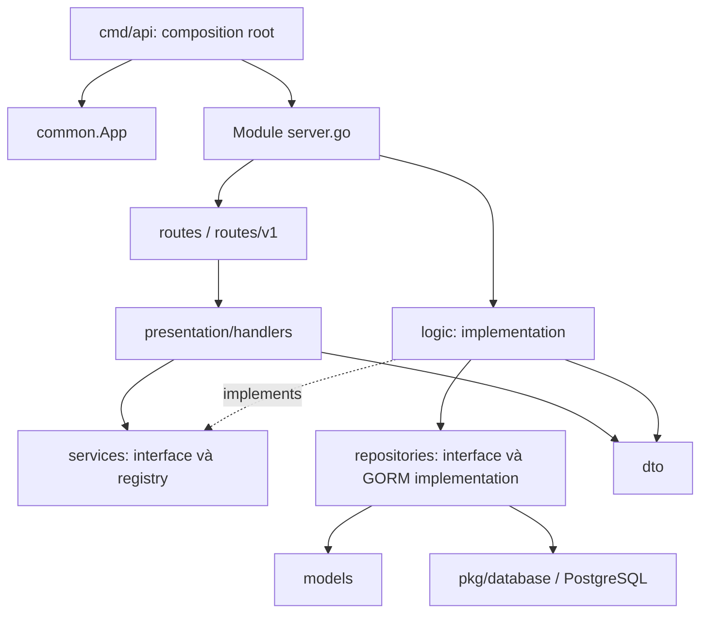

# Kiến trúc source code backend

**Trạng thái:** Người dùng đã duyệt kế hoạch và test case ngày 31/10/2026; scaffold đã được dựng. Các mục bên dưới lưu kế hoạch đã duyệt; xem [README](../README.md) và [kết quả kiểm chứng](scaffold-verification.md) cho hiện trạng bàn giao.

**Ngày:** 31/10/2026.

**Nguồn:** [Skill create-new-apis](../.agents/skills/SKILL.md) và [thiết kế nghiệp vụ hiện tại](backend-system-design.md).

## 1. Phạm vi và cơ sở thiết kế

Dựng backend mới theo **Clean Layered Modular Architecture**, dùng **Go 1.26, Gin, GORM và PostgreSQL** như skill quy định. Module path đề xuất là `sea-codex-server`, chưa giả định URL Git remote. Máy hiện tại có Go `1.26.0`.

Tại thời điểm lập kế hoạch, repository chỉ có tài liệu và skill, chưa có `go.mod`, source ứng dụng hoặc OpenAPI. Những phần trong tài liệu nghiệp vụ nói đến source “đã triển khai” là blueprint tham khảo từ hệ thống khác, chưa phải tính năng của repository này. Scaffold sau phê duyệt bổ sung các file theo phạm vi dưới đây.

Đợt đầu chỉ dựng nền tảng có thể build/run và các ranh giới module. Chỉ endpoint kỹ thuật `GET /health` được triển khai để kiểm chứng cấu trúc. Không làm signup/login, catalog, hồ sơ, upload, OCR, dashboard hoặc phê duyệt trong đợt scaffold.

Giữ nguyên phạm vi nghiệp vụ hiện tại: tenant là công ty với `company_id`; các trạng thái hồ sơ là `PROCESSING`, `MISSING_DOCUMENT`, `INVALID_DOCUMENT`, `VALID_DOCUMENT`, `APPROVED_DOCUMENT`, `REJECTED`. Không đưa trở lại stack NestJS, BullMQ hay luồng webhook/export của đề xuất cũ.

## 2. Ranh giới module

| Module | Trách nhiệm sau khi triển khai nghiệp vụ | Trong đợt scaffold |
| --- | --- | --- |
| `auth` | Company, user, đăng ký công ty nguyên tử, login, thành viên, role/permission | Tạo package theo layer và điểm wiring; chưa đăng ký API |
| `dossier` | Catalog/schema version, hồ sơ/checklist, upload, tài liệu/trang, trích xuất, đối soát, review, dashboard | Tạo package theo layer và điểm wiring; chưa đăng ký API |
| `audit` | Audit append-only, ghi sự kiện, truy vấn theo công ty và quyền | Tạo package theo layer và điểm wiring; chưa đăng ký API |
| `health` | Kiểm tra process HTTP còn hoạt động | Một luồng service → handler → route hoàn chỉnh, không truy vấn DB |
| `common` | App context, actor/tenant context, middleware, response/error, base model | Triển khai phần hạ tầng dùng chung |
| `pkg` | Config, database, logger, token và password helpers | Triển khai adapter hạ tầng, không chứa nghiệp vụ hồ sơ |

Chưa tách catalog/review/dashboard thành service độc lập. Trong `dossier`, mỗi nhóm dùng file riêng khi implement, ví dụ `catalog_service.go`, `reconciliation_service.go`; tránh gom tất cả vào một file. Chỉ tách module khi có nhu cầu thực tế về ownership hoặc triển khai.

## 3. Luồng phụ thuộc



Quy tắc import:

- `dto` chứa contract request/response, không truy cập DB hoặc gọi service.
- `models` chứa entity và constraint; không import handler/logic.
- `repositories` nhận `context.Context` đầu tiên, xử lý persistence và luôn giới hạn tenant cho dữ liệu công ty.
- `services` định nghĩa `I<Entity>Service`, `Register<Entity>Service()` và `<Entity>Service()`; không import concrete logic/repository.
- `logic` triển khai service interface, validation nghiệp vụ và điều phối transaction; không dùng `gin.Context`.
- `presentation/handlers` bind input và gọi service qua registry; không query GORM trực tiếp.
- `routes` gắn HTTP method/path/middleware; không chứa nghiệp vụ.
- `server.go` khởi tạo repository/logic, đăng ký service và route; đây là điểm wiring của từng module.
- `cmd/api` ghép hạ tầng và module; `pkg` không import `internal`.

Không cho `auth` import concrete `dossier/logic` hoặc ngược lại. Giao tiếp liên module bằng contract hẹp; ví dụ auth cung cấp bộ resolve actor, còn dossier nhận audit writer có cùng transaction qua interface. Không đặt toàn bộ service vào `common.App`.

## 4. Danh sách file scaffold được đề xuất

Danh sách dưới đây là file **sẽ tạo sau khi duyệt**, chưa phải file đã tồn tại. File `_test.go` được liệt kê ở mục 9.

### 4.1. Entrypoint và cấu hình dự án

```text
go.mod
go.sum
.gitignore
.env.example
Makefile
README.md
config/app.development.yaml
cmd/api/main.go
internal/bootstrap/app.go
internal/bootstrap/router.go
internal/bootstrap/shutdown.go
```

- `go.sum` được công cụ Go tạo sau khi resolve dependency, không điền checksum thủ công.
- `main.go` đọc cờ `--config`, gọi bootstrap và xử lý exit code; không chứa nghiệp vụ module.
- `app.go` khởi tạo config → logger → DB → token manager → Gin engine → `common.App` → đăng ký service/route.
- `router.go` gắn middleware và module theo thứ tự cố định; registry phải sẵn sàng trước khi nhận request.
- `shutdown.go` dừng nhận request, chờ HTTP shutdown có timeout rồi đóng connection pool.
- `.env.example` chỉ có placeholder, không chứa credential/key thật. Viper không được giả định tự đọc `.env`; README sẽ nêu rõ dùng YAML hoặc export biến môi trường.
- `.gitignore` loại binary, local config/secrets, log và upload runtime; không bỏ qua file mẫu hoặc `go.sum`.

### 4.2. Core packages

```text
pkg/config/config.go
pkg/config/load.go
pkg/database/postgres.go
pkg/logger/logger.go
pkg/token/claims.go
pkg/token/manager.go
pkg/utils/password.go
```

| File/nhóm | Contract và hành vi dự kiến |
| --- | --- |
| `config` | `LoadConfig`, typed config; YAML + env override; kiểm tra port, timeout, DB, auth keys và token lifetime |
| `database` | `InitPostgresDB`, dùng GORM PostgreSQL; nhận context, ping có timeout, cấu hình pool; không tự chạy migration |
| `logger` | `NewLogger`, Zerolog có structured fields và log level; không log password, token, DSN hoặc key |
| `token` | `ITokenManager`, `TokenClaims`, phát/xác minh PASETO **v4 public**; key pair cấu hình, kiểm tra hạn và chữ ký |
| `utils` | `HashPassword`, `CheckPasswordHash`, dùng bcrypt; không log plaintext/hash |

Token manager dùng thư viện PASETO, không tự viết thuật toán mật mã. Token chỉ xác thực danh tính; quyền và trạng thái user phải đọc từ DB. Không tự sinh signing key trong process API: thiếu/sai key thì startup lỗi rõ ràng. Key pair local được tạo chủ động bằng công cụ `cmd/keygen`; test dùng key ngẫu nhiên riêng.

Không cấu hình provider OCR, Redis hoặc queue thật khi chưa có xử lý nghiệp vụ. Sau này có thể bổ sung adapter file/AI/queue vào `pkg` mà không đổi API của handler.

### 4.3. Shared app, model, middleware và response

```text
internal/common/app.go
internal/common/actor.go
internal/common/identity.go
internal/common/errors.go
internal/common/models/base_model.go
internal/common/dto/response.go
internal/common/middlewares/request_id.go
internal/common/middlewares/logger.go
internal/common/middlewares/recovery.go
internal/common/middlewares/auth.go
internal/common/middlewares/permission.go
```

- `common.App` giữ config, `*gorm.DB`, logger, `token.ITokenManager`, Gin engine và `IdentityResolver` được inject. Không giữ actor của request trong biến global.
- `Actor` gồm user ID, company ID, email, role và quyền hiệu lực; đặt vào request context có kiểu, đồng thời cung cấp các key Gin mà skill yêu cầu.
- `IdentityResolver` là interface đọc user còn active, company còn hợp lệ và quyền hiện hành. Concrete implementation thuộc `auth/logic` ở giai đoạn auth; scaffold chỉ dùng fake trong test.
- `AuthMiddleware(app)` kiểm tra Bearer/PASETO, resolve actor rồi đặt `user_id`, `user_email`, `user_role`, `is_admin`, claims và `company_id`. Không lấy company từ body/query/header tùy ý.
- Chưa có resolver thì request được bảo vệ phải bị từ chối; không dùng fake user, không bỏ qua auth. `/health` là route public duy nhất trong scaffold.
- `is_admin` phục vụ tương thích contract, không cho phép truy cập xuyên tenant. Quyền được kiểm tra qua permission và phạm vi tài nguyên.
- `BaseModel` gồm UUID primary key, `CreatedAt`, `UpdatedAt`, `DeletedAt`; sinh UUID tại application để không phụ thuộc extension DB trong test.
- `BaseModel` không tự thêm soft delete vào audit: audit dùng model UUID/timestamp riêng, không có thao tác update/delete nghiệp vụ.
- Response dùng `dto.SuccessResponse(c, statusCode, message, data)` và `dto.ErrorResponse(c, statusCode, message)`. Envelope thống nhất `{code, message, data}`; error có `data: null`. Request ID nằm trong header phản hồi và log.
- Logger không đọc/log body, Authorization hoặc cookie. Recovery dùng error helper, không trả panic/stack cho client.

Thứ tự middleware toàn cục: request ID → access logger → recovery. Nhóm được bảo vệ thêm auth → permission; handler/service vẫn phải kiểm tra quyền trên tài nguyên cụ thể.

### 4.4. Module health: luồng tham chiếu hoàn chỉnh

```text
internal/health/dto/health_response.go
internal/health/services/health_service.go
internal/health/logic/health_logic.go
internal/health/presentation/handlers/health_handler.go
internal/health/routes/routes.go
internal/health/routes/v1/routes.go
internal/health/server.go
```

`GET /health` trả `200`, message và `data.status = "ok"` theo response helper. Đây là liveness của process, không khẳng định PostgreSQL/OCR đã sẵn sàng. Không tạo repository, model hoặc migration giả cho một chức năng không lưu dữ liệu. `routes/v1` giữ đúng layout của skill; route health được mount ngoài prefix nghiệp vụ `/api/v1`.

Service có interface/registry đúng skill; concrete logic nhận dependency qua constructor để test riêng. Registry chỉ dùng ở composition/HTTP boundary, đăng ký một lần trước khi server chạy; không đăng ký lại hoặc thay registry trong các test chạy song song.

### 4.5. Module nghiệp vụ: package boundaries, chưa có endpoint

```text
internal/auth/dto/doc.go
internal/auth/models/doc.go
internal/auth/migrations/doc.go
internal/auth/repositories/doc.go
internal/auth/services/doc.go
internal/auth/logic/doc.go
internal/auth/presentation/handlers/doc.go
internal/auth/routes/doc.go
internal/auth/routes/v1/doc.go
internal/auth/server.go

internal/dossier/dto/doc.go
internal/dossier/models/doc.go
internal/dossier/migrations/doc.go
internal/dossier/repositories/doc.go
internal/dossier/services/doc.go
internal/dossier/logic/doc.go
internal/dossier/presentation/handlers/doc.go
internal/dossier/routes/doc.go
internal/dossier/routes/v1/doc.go
internal/dossier/server.go

internal/audit/dto/doc.go
internal/audit/models/doc.go
internal/audit/migrations/doc.go
internal/audit/repositories/doc.go
internal/audit/services/doc.go
internal/audit/logic/doc.go
internal/audit/presentation/handlers/doc.go
internal/audit/routes/doc.go
internal/audit/routes/v1/doc.go
internal/audit/server.go
```

`doc.go` giải thích trách nhiệm package và chiều phụ thuộc, chưa khai báo entity/interface nghiệp vụ suy đoán. `server.go` có điểm wiring `RegisterServices(app *common.App)` và `NewServer(app *common.App)`; cả ba module chưa đăng ký service/route nghiệp vụ. Mỗi module dùng chung `app.Router`, không tạo HTTP server hoặc Gin engine riêng.

Không sinh endpoint giả trả thành công, không panic `not implemented` trong đường chạy startup, không thêm `AutoMigrate` lên model chưa tồn tại. README phân biệt rõ module mới chỉ có khung với module đã hoạt động.

### 4.6. Tài liệu API

```text
docs/api/api_spec.json
```

Chỉ tạo OpenAPI sau khi build/test scaffold đạt theo skill. Spec chỉ mô tả `/health` thực sự đã chạy, response envelope và HTTP status; không đưa login/signup hoặc API dự kiến vào phần đã triển khai. Bổ sung spec cùng mỗi tính năng sau khi được duyệt và kiểm chứng.

## 5. Data ownership, tenant và transaction

Các quy tắc sau định hướng khi triển khai module; đợt scaffold chưa tạo bảng company/user/dossier:

| Chủ sở hữu | Nhóm entity tương lai |
| --- | --- |
| `auth` | Company, User, role/quyền, trạng thái thành viên |
| `dossier` | Document type/schema versions, dossier type/relations/rules, Dossier, Batch/File, DocumentGroup/Page, Extraction/Correction, Checklist, Issue, Decision, StatusHistory |
| `audit` | AuditLog theo company, actor, action, resource và timestamp |

- Repo nghiệp vụ nhận company scope rõ ràng; mọi lookup/update/delete dùng ID **và** `company_id`, bao gồm tài nguyên con. Không có method đọc toàn bộ tenant mặc định.
- Model user và entity công ty có `company_id`; liên kết con phải được kiểm tra cùng tenant. Mã cấu hình dùng unique constraint theo company, không chỉ kiểm tra ở service.
- Xác thực đọc user theo ID từ token là bootstrap của actor, trước khi có company scope; cần query chuyên biệt, không biến thành đường đọc user tùy ý công khai.
- Không lưu `company_id` chỉ trong GORM session global vì connection/request có thể được tái sử dụng. RLS, nếu thêm, phải có PostgreSQL integration test riêng.
- Service/logic mở transaction cho thao tác nhiều entity và truyền cùng `tx` tới repository/audit writer. Repository không tự commit một phần của nghiệp vụ.
- Signup sau này tạo company + admin nguyên tử; review/correction/status history + audit cũng phải cùng transaction.
- Không giữ transaction hoặc khóa hàng trong lúc gọi OCR/provider, đọc PDF hoặc truyền file qua mạng.
- Reconciliation/review dùng data version và kiểm tra concurrency; kết quả worker cũ không được ghi đè dữ liệu mới. Chi tiết entity/state sẽ được duyệt cùng module dossier.

Migration theo skill đặt trong `internal/<module>/migrations/migrate.go`, dùng GORM `AutoMigrate` cho model của module. Chỉ bổ sung khi có entity. Startup migration phải là opt-in; thay đổi dữ liệu, constraint liên tenant hoặc backfill phức tạp cần migration có version và kiểm thử riêng trước production.

## 6. Quy ước lỗi và cấu hình

Sentinel error dùng chung: `ErrInvalidArgument`, `ErrUnauthenticated`, `ErrForbidden`, `ErrNotFound`, `ErrConflict`, `ErrUnavailable`. Logic/repository wrap nguyên nhân bằng `%w`; handler/middleware dùng `errors.Is` để ánh xạ HTTP. Không so sánh chuỗi lỗi.

| Loại lỗi | HTTP | Nội dung công khai |
| --- | --- | --- |
| Input/binding không hợp lệ | 400 | Thông báo validation an toàn |
| Thiếu/sai/hết hạn token, user không hoạt động | 401 | Không xác thực được |
| Thiếu quyền | 403 | Không có quyền thực hiện |
| Tài nguyên không có hoặc khác tenant | 404 | Không tìm thấy tài nguyên |
| Version/status conflict | 409 | Dữ liệu đã thay đổi hoặc thao tác không hợp lệ |
| Dependency lỗi hoặc chưa cấu hình | 503 | Dịch vụ tạm thời chưa sẵn sàng |
| Lỗi không dự kiến | 500 | Lỗi hệ thống; nguyên nhân chỉ ghi log an toàn |

Đợt scaffold chưa có transaction nghiệp vụ; DB initialization lỗi thì startup dừng và giải phóng tài nguyên đã mở. Không trả `401` cho lỗi DB/resolver tạm thời vì đó không phải lỗi credential.

Config tối thiểu: HTTP host/port/mode/timeouts/shutdown timeout; PostgreSQL host/port/user/password/dbname/sslmode/pool; auth key pair/token duration; logger level. YAML mẫu dùng key trống và hướng dẫn cấu hình; không có production secret, không tự bật migration hoặc tắt kiểm tra auth.

## 7. Startup và lifecycle

1. Parse cờ config, load/validate cấu hình; lỗi thì dừng với thông báo không chứa secret.
2. Tạo logger; mở và ping PostgreSQL với timeout, khởi tạo token manager bằng key pair ổn định.
3. Tạo Gin engine và `common.App`; gắn middleware toàn cục.
4. Gọi `RegisterServices` cho các module, sau đó `NewServer`; scaffold chỉ mount `/health`.
5. Chạy `http.Server` với timeout; nghe SIGINT/SIGTERM, shutdown có deadline và đóng DB pool.

Không khởi động worker OCR trong đợt scaffold. Chưa tạo `cmd/worker` rỗng hoặc lựa chọn queue backend khi chưa có kế hoạch xử lý tương ứng. Hạ tầng nền tảng yêu cầu DB khi startup dù liveness không query DB trên mỗi request.

## 8. Kế hoạch thực hiện sau khi được duyệt

1. Tạo `go.mod`, config, logger, DB, token/password helpers và dependency được khóa trong `go.mod`/`go.sum`.
2. Tạo shared context/model/response/errors/middleware và test các ràng buộc bảo mật.
3. Dựng health theo luồng DTO → service/logic → handler → routes → server.go.
4. Tạo package boundaries `auth`, `dossier`, `audit`, ghép bootstrap và graceful shutdown.
5. Chạy format, build, vet và test; sửa các lỗi trong phạm vi scaffold.
6. Sau khi kiểm tra đạt mới tạo `docs/api/api_spec.json`; cập nhật README, Makefile và config mẫu đúng lệnh thực tế.

Không tự triển khai auth hoặc hồ sơ sau bước 6. Các module nghiệp vụ tiếp theo có kế hoạch/test case riêng theo skill.

## 9. Test case cần duyệt cùng kế hoạch

Dùng `testing`, `testify/assert`, `testify/require`, table-driven tests và `httptest` như skill. Chỉ thêm test cho hành vi thật của scaffold; không test thư mục rỗng.

| Nhóm | File test dự kiến | Tình huống và kỳ vọng |
| --- | --- | --- |
| Config — happy/edge/validation | `pkg/config/load_test.go` | YAML hợp lệ; env override; thiếu file; port/timeout/level không hợp lệ; thiếu DB/key; lỗi không lộ secret |
| Token — happy/unauthorized | `pkg/token/manager_test.go` | Issue/verify hợp lệ; expired; token sửa nội dung; sai public key; malformed key/token; lifetime không hợp lệ |
| Password — happy/validation | `pkg/utils/password_test.go` | Hash không bằng plaintext; đúng/sai password; input vượt giới hạn bcrypt trả lỗi thay vì cắt ngầm |
| Base model | `internal/common/models/base_model_test.go` | GORM tạo UUID/timestamp đúng, không cần extension PostgreSQL; dùng model test và SQLite in-memory |
| Response — happy/error | `internal/common/dto/response_test.go` | Status và `{code,message,data}` nhất quán; error không lộ stack/raw cause |
| Middleware — unauthorized/forbidden/failure | `internal/common/middlewares/auth_test.go` | Thiếu/sai/hết hạn Bearer → 401; user inactive → 401; resolver chưa có/lỗi hạ tầng → 503; actor/company lấy từ resolver, không từ request hoặc claim quyền cũ |
| Middleware — permission | `internal/common/middlewares/permission_test.go` | Có quyền được đi tiếp, thiếu quyền → 403; không dùng `is_admin` để vượt company scope |
| Middleware — lifecycle | `internal/common/middlewares/http_test.go` | Có request ID; panic được recovery thành JSON 500; log không chứa Authorization/password từ request |
| Service — happy | `internal/health/logic/health_logic_test.go` | Concrete service trả trạng thái liveness; không cần DB/repository |
| HTTP integration | `internal/health/presentation/handlers/health_handler_test.go` | `GET /health` → 200 đúng envelope; method/path không hỗ trợ không thành 200; chỉ đăng ký registry trong setup tuần tự |
| Wiring | `internal/bootstrap/router_test.go` | Router dùng cùng app; chỉ có health; không vô tình mount API nghiệp vụ hoặc bỏ qua auth cho nhóm protected |

**DB failures:** Scaffold phải dừng khi PostgreSQL không kết nối được hoặc hết timeout. Xác minh thủ công trên môi trường test/local và ghi kết quả thực tế; không dùng SQLite để kết luận driver PostgreSQL hoạt động. Test repository/transaction/tenant isolation bằng PostgreSQL thật sẽ được bổ sung khi triển khai entity nghiệp vụ; SQLite chỉ kiểm tra mapping/model đơn giản.

Lệnh kiểm chứng dự kiến:

```bash
gofmt -l ./cmd ./internal ./pkg
go vet ./...
go test ./...
go build -o bin/api ./cmd/api
```

Sau khi có config/key/DB hợp lệ, chạy server local và kiểm tra `GET /health`; thử shutdown và startup với DB lỗi. Nếu môi trường thiếu dependency/DB, ghi rõ phần chưa kiểm chứng, không đánh dấu đạt. Không cập nhật OpenAPI dựa trên endpoint chưa implement.

## 10. Kết quả bàn giao của đợt scaffold

- Source build được theo layout skill; module boundary và startup rõ ràng.
- `GET /health` có test và OpenAPI đúng hành vi.
- Core config, DB, logger, PASETO, bcrypt và middleware có implementation/test trong phạm vi nêu trên.
- Auth middleware fail closed; chưa có API nghiệp vụ, chưa có tenant data hoặc OCR provider thật.
- README có bước tạo key, chuẩn bị PostgreSQL, cấu hình, chạy/build/test và danh sách phần chưa triển khai.
- Tài liệu nghiệp vụ hiện tại được giữ nguyên; không đổi scope sản phẩm trong lúc dựng architecture.

## 11. Phê duyệt và cập nhật triển khai

Người dùng đã duyệt **phạm vi/file scaffold ở mục 4–8** và **test case ở mục 9**, đồng thời yêu cầu bám theo bản `backend-system-design.md` cập nhật. Không cần xin xác nhận lại trong phạm vi scaffold này.

Các bổ sung phục vụ chạy/kiểm chứng trong cùng phạm vi: `cmd/keygen/main.go` là công cụ cấp key chủ động, tách khỏi startup API; `internal/common/actor_test.go`, `internal/common/errors_test.go`, `pkg/database/postgres_test.go` kiểm tra cách ly request context, ánh xạ lỗi và xử lý lỗi kết nối. Không thêm API nghiệp vụ hoặc worker/provider.
