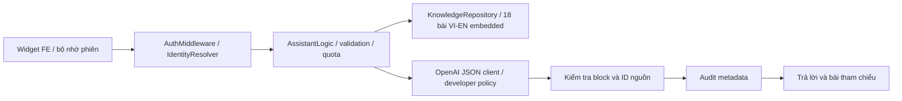

# Trợ lý DocSense

Phạm vi đã duyệt: hướng dẫn sử dụng và giải thích quy trình. Source triển khai ở branch `codex/system-assistant` của BE và FE. Chưa triển khai production.

## Hành vi

Bot xuất hiện trong workspace sau đăng nhập, hỗ trợ VI/EN, câu hỏi gợi ý theo màn hình và trích dẫn đến bài hướng dẫn. Bản demo dùng FAQ local có nhãn riêng, không gọi AI.

Bot giải thích tiếp nhận nhiều đợt, phân loại/OCR, checklist, đối soát, correction, kiểm duyệt/mở lại, quyền/thành viên, cấu hình phiên bản, dashboard và audit. Bot không có công cụ đọc dữ liệu hồ sơ, reveal PII, sửa/cấp quyền hoặc ghi quyết định nghiệp vụ. Người dùng không nên nhập dữ liệu cá nhân hay nội dung giấy tờ vào chat; văn bản họ nhập được gửi tới OpenAI khi tính năng AI được bật.

## Kiến trúc thực tế



Module `internal/assistant` giữ các layer `dto`, `models`, `repositories`, `services`, `logic`, `presentation/handlers`, `routes`, `server.go`. Model bài hướng dẫn là value object, không tạo bảng/migration. Repository không truy vấn bảng hồ sơ. Service dùng `AuditWriter` hiện có để ghi event theo tenant và actor đã xác thực.

Knowledge được nhúng trong binary bằng `go:embed`. Mỗi bài Markdown có JSON metadata ở dòng đầu, sau đó hai phần `## vi` và `## en`; chính nội dung hai phần này được đọc vào corpus. Metadata gồm ID, version, alias, trang liên quan, nguồn source và revision kiểm chứng. Xem [quy tắc bảo trì](system-assistant-knowledge.md).

Retrieval chuẩn hóa VI có/không dấu và EN, ranking theo độ hiếm từ, alias và page hint; lấy tối đa 5 bài, tổng content VI+EN không quá 16.000 Unicode code points. Follow-up ngắn dùng lượt user gần nhất để bổ sung truy vấn; lịch sử không bao giờ là nguồn nghiệp vụ. Chưa dùng vector database/fine-tuning.

Model nhận developer policy riêng và user payload JSON gồm câu hỏi, lịch sử giới hạn, locale, page enum, role/permissions và các bài liên quan. Không tự gửi company ID, user ID, email, dossier ID hoặc nội dung trang. Nếu chính người dùng nhập ID/PII vào câu hỏi, văn bản đó vẫn thuộc input của họ; không tuyên bố tự động loại bỏ mọi PII.

Server chỉ chấp nhận response có `status` và `blocks`. Mỗi block kiến thức phải trích ID đã retrieve. Title, excerpt và article path được server tạo từ corpus. Các trạng thái từ chối/không đủ thông tin được chuyển thành thông báo cố định VI/EN. ID nguồn đúng không tự chứng minh nội dung đúng; cần nghiệm thu model thật theo [test cases](system-assistant-acceptance-cases.md).

## API

Tất cả endpoint được bảo vệ bởi PASETO và resolver user/company active hiện có. Tenant/role không lấy từ body; unknown fields bị từ chối. Hướng dẫn chung có thể đọc bởi các thành viên đang hoạt động, kể cả bot AI bị tắt.

| Method | Path | Chức năng |
| --- | --- | --- |
| GET | `/api/v1/assistant/context?locale=vi&page=detail` | enabled, version, gợi ý và danh mục bài |
| GET | `/api/v1/assistant/articles/:id?locale=vi` | bài hướng dẫn, không trả source code |
| POST | `/api/v1/assistant/chat` | hỏi đáp có nguồn và audit metadata |

Chat body: `{message, locale, page:{name,tab}, history:[{role,content}]}`. `locale` là `vi|en`; history role chỉ `user|assistant`. Page name: rỗng, `dashboard|dossiers|detail|review|members|catalog|audit|connection`; tab: rỗng, `overview|documents|issues|history`.

Envelope hiện có `{code,message,data}` được giữ nguyên. Chat data: `status`, `blocks:[{text,source_ids}]`, `sources:[{id,title,excerpt,article_path}]`, `suggestions`, `knowledge_version`, `request_id`. Status: `answered|out_of_scope|insufficient_information`. Article path dùng để lấy bài rồi render trong panel, không điều hướng như trang HTML.

| Điều kiện | Kết quả |
| --- | --- |
| Token/user/company không hợp lệ | 401 |
| Body/query/locale/page/history sai | 400 |
| Body >32 KiB | 413 |
| Article không tồn tại | 404 |
| Vượt rate/concurrency/capacity limiter | 429 + Retry-After |
| AI tắt, provider timeout/refusal/JSON sai, citation sai, audit lỗi | 503, không lộ body provider/key |

Input: message 1–2.000 code points; history tối đa 8 lượt, 2.000/lượt, tổng 12.000; response model tối đa 6 block, tổng text 6.000. Với ID hồ sơ nhận diện được trong câu hỏi, server thêm thông báo không tra cứu dữ liệu cụ thể. Đây là nhắc phạm vi, không phải bộ nhận diện tất cả mã hồ sơ/PII.

Quota mặc định 10 request/phút theo company+actor; concurrency 4/instance. Map rate có TTL, tối đa 10.000 key. Nhiều replica cần shared limiter trước khi xem hạn mức là toàn hệ thống. Request hủy/timeout giải phóng slot; không giữ transaction DB trong thời gian gọi model.

Audit ghi `ASSISTANT_ANSWERED|ASSISTANT_REFUSED`, resource `assistant_request`, resource UUID mới; metadata chỉ có knowledge version, article IDs, outcome, model, latency. Không lưu prompt/question/answer/history. Audit lỗi trả 503 và không tự gọi model lại. Model có thể đã phát sinh phí trước lỗi audit, không coi đây là rollback provider.

## FE và phiên

FE tại `/Users/thanhpham/Documents/itmo-vodka-sea-codex-fe`: `assistant.js` dựng widget DOM an toàn; `assistant-state.js` quản lý request/history/abort; `assistant-demo.js` cung cấp FAQ mẫu; `assistant.css` và `backend-service.js` nối transport hiện có.

Widget nằm ngoài vùng `#app` bị render lại. Đổi trang giữ cuộc trò chuyện, đổi user/company/session/permissions hoặc logout xóa lịch sử và hủy request. Đổi ngôn ngữ hủy request cũ và tải context mới. Lịch sử không lưu localStorage/URL. Render bằng textContent, không thực thi HTML hoặc URL của model. Citation mở bài theo ID allowlist; không thêm link thao tác nghiệp vụ từ model.

FE chat timeout 70s, proxy chỉ dành riêng endpoint chat tối thiểu 65s, BE timeout mặc định 30s và giới hạn config tối đa 60s. Go WriteTimeout phải lớn hơn assistant timeout. Các API khác giữ timeout hiện tại. Không đổi Caddy/port/service: Browser → Caddy → frontend:80 → api:8080.

Tham khảo transport: [OpenAI Chat Completions](https://developers.openai.com/api/reference/resources/chat/subresources/completions/methods/create). JSON mode được kiểm tra schema/citation tại BE, không đồng nghĩa đảm bảo chất lượng nội dung.

## Cấu hình và triển khai

Mặc định `ASSISTANT_ENABLED=false`. Khai báo riêng với OCR:

```dotenv
ASSISTANT_ENABLED=true
ASSISTANT_BASE_URL=https://api.openai.com
ASSISTANT_API_KEY=<key chỉ đặt trong môi trường BE>
ASSISTANT_MODEL=<model hỗ trợ Chat Completions JSON đã đánh giá>
ASSISTANT_TIMEOUT=30s
ASSISTANT_MAX_OUTPUT_TOKENS=1500
ASSISTANT_REQUEST_LIMIT=10
ASSISTANT_RATE_WINDOW=1m
ASSISTANT_MAX_CONCURRENT_REQUESTS=4
```

API key không đưa vào frontend, Dockerfile hoặc source. Bật AI yêu cầu key/model và OpenAI HTTPS endpoint hợp lệ. Overlay Compose hỗ trợ dùng chung với OCR OpenAI: nếu `ASSISTANT_API_KEY`/`ASSISTANT_MODEL` trống hoặc chưa đặt, lấy tương ứng `PROCESSING_API_KEY`/`PROCESSING_MODEL`. Giá trị assistant riêng có ưu tiên cao hơn. `ASSISTANT_ENABLED` vẫn phải bật riêng; không cần bật worker OCR chỉ để dùng chatbot.

Để dùng chung, giữ key/model OCR đang có trong `.env`, đặt `ASSISTANT_ENABLED=true` và để trống hoặc bỏ hai biến assistant key/model. Nếu chỉnh trực tiếp Compose trên VM, thêm vào `api.environment`:

```yaml
      - ASSISTANT_ENABLED=${ASSISTANT_ENABLED:-false}
      - ASSISTANT_API_KEY=${ASSISTANT_API_KEY:-${PROCESSING_API_KEY:-}}
      - ASSISTANT_MODEL=${ASSISTANT_MODEL:-${PROCESSING_MODEL:-}}
      - ASSISTANT_BASE_URL=${ASSISTANT_BASE_URL:-https://api.openai.com}
```

Fallback này được thực hiện khi Compose nội suy biến từ shell/`.env`, không phải fallback trong Go config. Chạy bằng `docker run` hoặc ngoài Compose cần truyền key/model vào `ASSISTANT_*` rõ ràng. Model dùng chung cần hỗ trợ Chat Completions JSON của OpenAI; các giới hạn và cờ bật/tắt assistant vẫn độc lập.

Repo có [docker-compose.yml](../docker-compose.yml) theo Compose VM người dùng cung cấp: frontend cổng 80, database mặc định `sea_codex_db_v2`, và truyền `ASSISTANT_*` với fallback OCR vào service `api`. Khi dùng file này, chỉ cần đặt `ASSISTANT_ENABLED=true` trong `.env`, giữ key/model OCR hợp lệ rồi chạy `docker compose config --quiet` và `docker compose up -d --no-deps --force-recreate api`. Sau đó tải lại trang/đăng nhập lại để FE lấy context mới. Thêm biến vào `.env` mà Compose không tham chiếu thì biến không được truyền vào container.

Nếu giữ một bản Compose khác chưa có các biến assistant, có thể dùng overlay [compose.assistant.yaml](../config/compose.assistant.yaml) thay vì chèn thủ công. Sau khi build/publish image BE/FE mới và copy overlay lên VM, thêm các biến trên vào `.env` của Compose rồi dùng:

```bash
docker compose -f docker-compose.yml -f config/compose.assistant.yaml config --quiet
docker compose -f docker-compose.yml -f config/compose.assistant.yaml pull api frontend
docker compose -f docker-compose.yml -f config/compose.assistant.yaml up -d --no-deps --force-recreate api frontend
docker compose -f docker-compose.yml -f config/compose.assistant.yaml logs --tail 50 api
```

Với cách dùng overlay, luôn dùng cả hai file để giữ cấu hình. Bản `docker-compose.yml` mới đã tích hợp assistant nên không cần overlay. Nếu image/tag VM chưa chứa thay đổi branch này, pull latest không tự có chatbot. Không cần đổi database hay xóa volume. Muốn tắt chỉ đặt `ASSISTANT_ENABLED=false` và recreate api; thư viện bài vẫn hoạt động.
